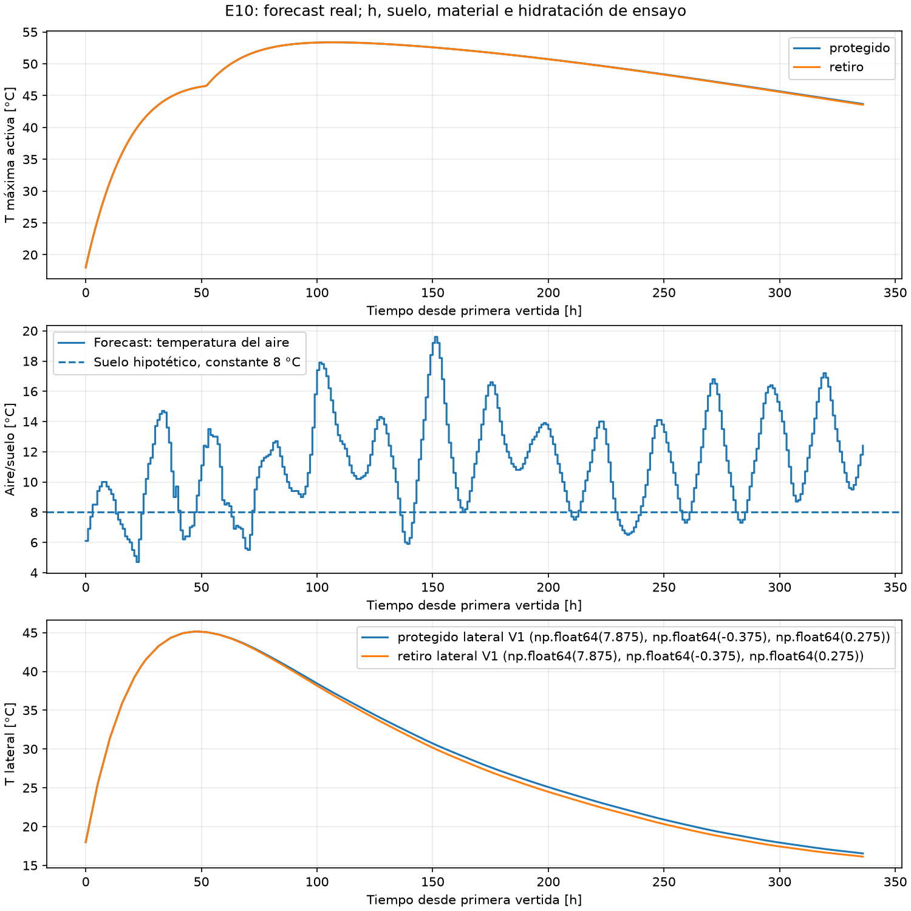

# E10 — Entorno, moldaje y clima trazable

## Implementado

- Loader Open-Meteo en `therma/meteorologia.py` y CLI `clima.py`.
- Snapshots separados en `data/weather/<UTC>_<id>/forecast.json` y `metadata.json`.
- Se conserva el JSON original byte por byte, con SHA-256 verificado al cargar.
- Metadata: consulta completa, proveedor/producto, coordenadas solicitadas y devueltas,
  variables, unidades, descarga UTC y extremos de cobertura. `best_match` combina modelos:
  no se inventa una hora de emisión; `model_run_issued_at` permanece nulo.
- Temperatura horaria conectada al motor Python en caras Robin expuestas al aire.
- Suelo basal exclusivo, mediante reservorio efectivo con su propia temperatura.
- Moldaje como resistencia e/k y retiro global opcional mediante `remove_at_h`.
- Interfaz THERMA para cargar la serie y programar el retiro. Cambios dejan STALE.

La descarga no se repite al simular: cada corrida conserva la serie y procedencia en
config.json/metadata.json. La simulación y la carga funcionan sin Internet una vez
descargado el forecast; sólo `clima.py descargar` necesita conexión. No hay dependencias
Python adicionales. Se utilizan las coordenadas exactas de `sitio.json`.

## Descargar y comprobar

Desde la raíz del proyecto:

```powershell
.\.venv\Scripts\python.exe clima.py descargar
```

Cada llamada crea un directorio nuevo; nunca sobrescribe una descarga anterior.
La respuesta puede provenir de una celda meteorológica distinta de las coordenadas
solicitadas: ambas ubicaciones quedan guardadas. Las temperaturas son °C y el viento
m/s. Los tiempos Unix se convierten a UTC; el inicio del cálculo exige zona horaria.
Se rechazan huecos, duplicados, desorden, nulos, valores no finitos y unidades incorrectas.

Snapshot de demostración descargado el 10-11-2026 a las 19:53:15 UTC:

`data/weather/20261110T195315635244Z_c23c3ffc`

Cubre 10-11-2026 00:00 UTC a 25-11-2026 23:00 UTC. Contiene 384 registros horarios.
SHA-256 original: `9fdf63d3d95fefb334379000f1e2de05cfd3aec4a2f993b8e009db2ecfde5d70`.

```powershell
.\.venv\Scripts\python.exe clima.py inspeccionar data/weather/20261110T195315635244Z_c23c3ffc --inicio 2026-11-11T08:00:00-03:00 --dias 14
```

Este inicio de laboratorio sí queda cubierto. El mismo comando con inicio el
27 de noviembre y 14 días se rechaza: **no hay forecast suficiente**. No se prolonga
el último valor ni se presenta una climatología como si fuera pronóstico. Para
el plan del 27 se necesitan futuras descargas o una cola de escenarios justificada
y etiquetada. Este desarrollo aún no genera esa cola automáticamente.

## Demo física reproducible

```powershell
.\.venv\Scripts\python.exe demo_e10.py data/weather/20261110T195315635244Z_c23c3ffc --inicio 2026-11-11T08:00:00-03:00 --dias 14
```

Produce dos corridas: moldaje mantenido y retiro a 48 horas globales; config, campos,
metadata, balance y figura en `resultados/e10/<UTC>/`. Incluye hidratación exponencial
didáctica y vertidas a 0/24/48 h. Suelo hipotético a 8 °C, ks=1.5 W/(m K), Ls=1 m,
Rcontacto=0.05 m²K/W. Material, suelo y moldaje **no están calibrados**.

Ambas corridas dan Tmax≈53.38 °C: la diferencia del máximo global es sólo 0.00011 °C
en este caso. No implica que el moldaje sea irrelevante: controla zonas expuestas;
se deben comparar temperaturas locales y energía, no sólo el máximo del núcleo.
Los residuales relativos de energía son menores que 2e-15.



El aire se aproxima constante por intervalo horario. El integrador se detiene en
cambios horarios, activaciones y desmolde; actualiza conductancias y CFL conservando
temperaturas y energía almacenada. Al retirar se elimina sólo e/k del moldaje:
la resistencia adicional R de las otras protecciones permanece. El retiro global
ocurre desde el inicio de la simulación, no a cierta edad de cada vertida.

## En el panel

1. Ejecutar `construir_panel.py` y reiniciar `servidor_therma.py`. Abrir
   http://127.0.0.1:8767/ y recargar si estaba abierto.
2. Elegir **Fundación · secuencia constructiva didáctica**.
3. En **05B Forecast trazable**, cargar `docs/e10/weather_para_panel.json`.
   Es la serie normalizada, no el JSON crudo del proveedor. También se genera en
   la carpeta de cada demo. Se muestra fuente, cobertura, fecha y hash.
4. Elegir inicio y duración compatibles con la cobertura. Activar la casilla de aire horario.
5. Configurar **05A** suelo y **03B** moldaje; para desmolde activar retiro y hora global.
6. Ejecutar Python. La configuración guardada contiene toda la serie para reproducirla.
   En el visor de ecuaciones, «última simulación» usa tiempo del snapshot para el
   aire y la presencia de moldaje; «entradas actuales» evalúa el inicio de la configuración.

La captura de prueba usa suelo a 10 °C y Rcontacto=0 (valores iniciales del panel),
por lo que no debe confundirse con la demo CLI de suelo a 8 °C y Rcontacto=0.05.

## Respuestas orales

**¿Dónde entra Taire?** En Robin: P=G(Taire−Ti). G=A/[d/(2kc)+R+e/km+1/h].
La temperatura del aire no se impone al centro del voxel.

**¿Viento?** Se archiva, pero h permanece constante declarado por cara. No existe
correlación h(v) calibrada. Sensación térmica no sustituye temperatura del aire.

**¿Desmolde?** Cambia la resistencia y puede acelerar enfriamiento superficial;
se reconstruye el borde y se revisa estabilidad. No se elimina energía del hormigón.

**¿Solar?** Sería un flujo absorbido a·Iinc [W/m²], por área y orientación.
No está implementado ni se añade como hidratación. La radiación térmica de onda
larga tampoco está implementada. h se interpreta puramente convectivo; si se
adopta un coeficiente combinado no se debe sumar su radiación nuevamente.

**¿Suelo?** Psuelo=Gsuelo(Treservorio−Ti), con resistencia de contacto y Ls/ks.
Sin almacenamiento de suelo. Las caras basales no reciben además convección de aire.

**¿Tipos de datos?** Forecast predice; observación mide; reanalysis reconstruye
el pasado usando modelos y observaciones. Esta descarga es forecast, no observación.
El loader acepta series de otros tipos sólo si se declara explícitamente `kind`
y procedencia; el cliente de red implementado descarga únicamente forecast.

**¿Por qué conservar forecasts?** Para reproducir qué información había al decidir,
comparar revisiones y analizar error sin información futura. Descarga no es emisión.

## Límites

S25 y fisuración mecánica no evaluados; geometría e hidratación provisionales.
No hay atmósfera/viento/radiación completos ni pronóstico válido para el 27 aún.
El cliente es de snapshot del producto best_match, no una captura garantizada de
una corrida meteorológica individual. Los JSON guardados hacen reproducible el dato recibido.

Fuentes oficiales: [Forecast API](https://open-meteo.com/en/docs),
[reanálisis](https://open-meteo.com/en/docs/historical-weather-api),
[forecast histórico y corridas](https://open-meteo.com/en/docs/historical-forecast-api).

Pruebas sin red: `python -m pytest tests/test_meteorologia.py -q`.
