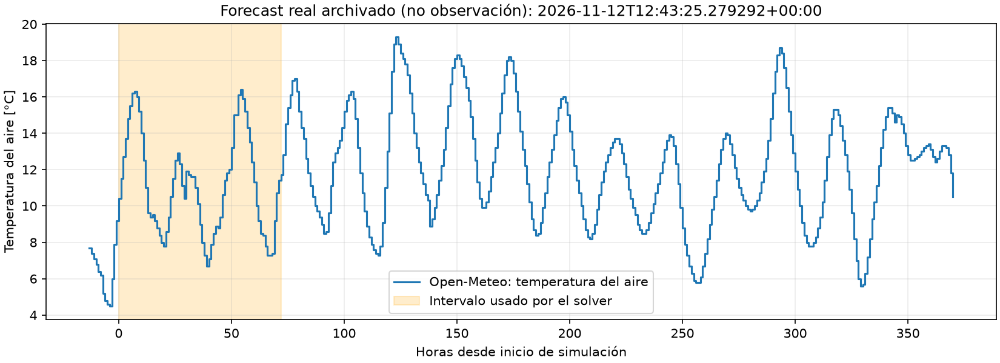
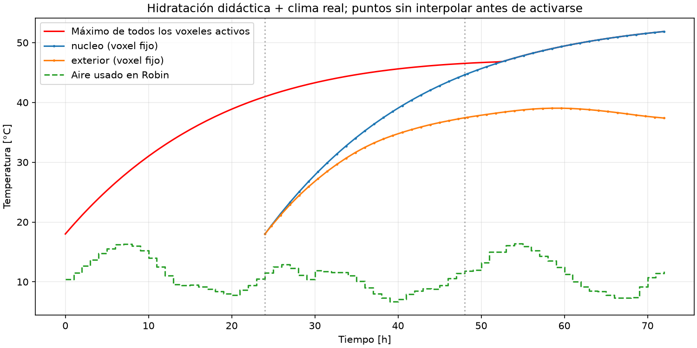
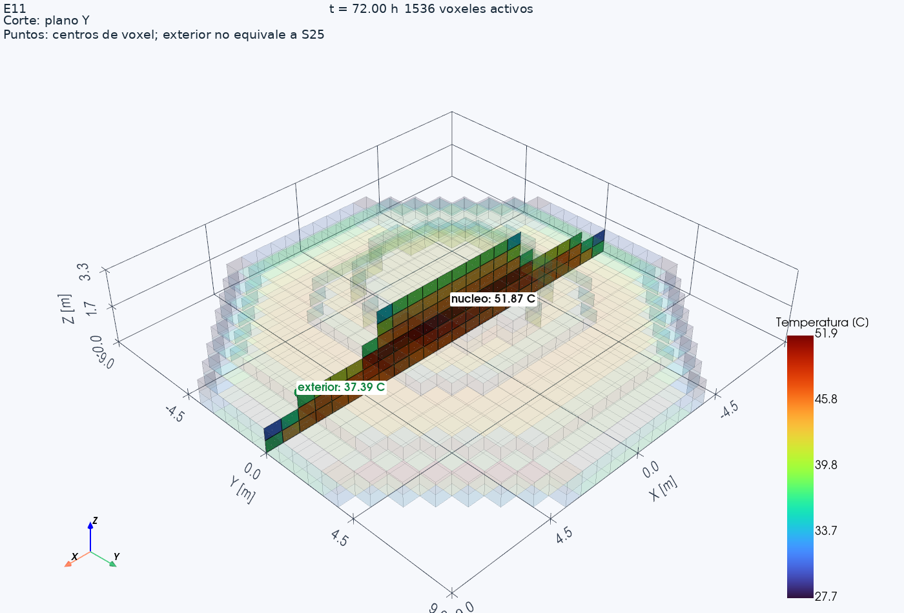
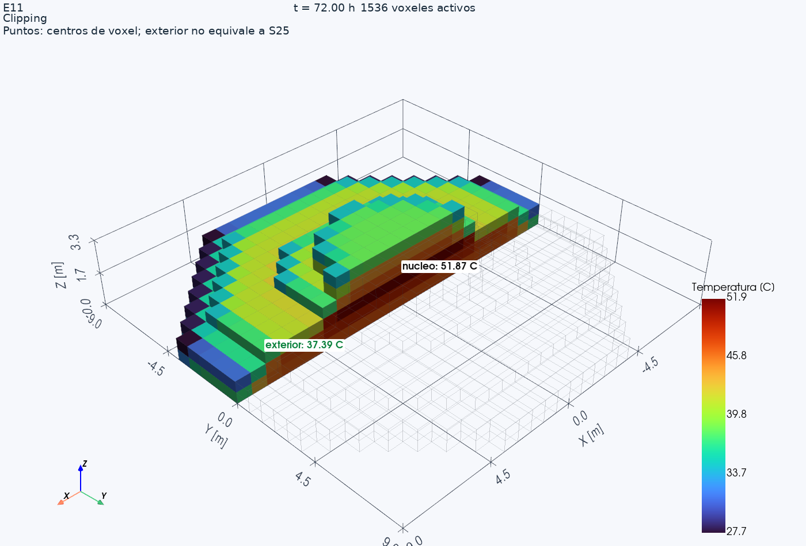

# E11 — Clima real, borde Robin y resultados 3D inspeccionables

## Preparación

Desde la raíz del proyecto, instalar las dependencias opcionales de visualización:

```powershell
.\.venv\Scripts\python.exe -m pip install -r requirements-viz.txt
```

El motor sigue siendo Python/NumPy; PyVista/VTK se usan para exportar y explorar.
No hace falta abrir Blender para esta demostración. El IFC se usa para obtener la
geometría y las tres vertidas; los parámetros térmicos siguen siendo de ensayo.

## Guion de los ocho pasos

**1. Mostrar el archivo meteorológico.** Abrir
`data/weather/20261112T124325279292Z_a139765f/forecast.json`. Es la respuesta
original de Open-Meteo, sin modificar: contiene `hourly.time`,
`hourly.temperature_2m` y `hourly.wind_speed_10m`. Son tiempos Unix UTC, °C y m/s.
Este archivo es un **pronóstico real archivado**, no una observación de estación.
Una vez descargado, toda esta demostración puede repetirse sin Internet.

**2. Mostrar metadata.** Abrir `metadata.json` junto al forecast. La descarga se
realizó el 12-11-2026 a las 12:43:25 UTC; hay 384 horas, desde el 12-11 00:00 UTC
hasta el 27-11 23:00 UTC. Coordenadas solicitadas: -52.821770, -70.896850, sitio
Punta Arenas/Tehuel Aike; la celda devuelta es -52.829525, -70.91934. Se conservan
URL, consulta, unidades, proveedor, producto y SHA-256:
`3a6a828efa343ee586a3a8e211475decb13678c6a8227d700316f2875d1c5dab`.
`best_match` combina modelos y no entrega una hora única de emisión: queda nula,
en lugar de confundirla con la hora de descarga. Comprobar integridad/cobertura:

```powershell
.\.venv\Scripts\python.exe clima.py inspeccionar data/weather/20261112T124325279292Z_a139765f --inicio 2026-11-12T10:00:00-03:00 --dias 3
```

**3. Graficar temperatura ambiente.** Abrir
`docs/e11/evidencia/temperatura_ambiente.png`. La zona naranja marca las 72 h usadas.
El gráfico conserva toda la cobertura del snapshot; el solver toma sólo su ventana.

**4. Alimentar una BC.** En `demo_e11.py`, `configuracion_snapshot` produce la serie
`weather`, que se pasa a `ejecutar`. En `therma/construccion.py`, `bordes_en(t)`
llama `weather.temperatura(t)` para la temperatura externa de cada cara Robin.
El integrador termina pasos en cada cambio horario; usa valores constantes por
intervalo, sin extrapolar. El contacto basal exclusivo mantiene el suelo a 8 °C,
sin reemplazarlo por la temperatura del aire.

La ecuación exacta de potencia que entra al voxel por una cara Robin es:

\[
P_{aire,i}=\frac{A_f\,[T_{aire}(t)-T_i]}{\Delta n/(2k_c)+R_{adicional}+e_m/k_m+1/h}.
\]

Aquí A es área [m²], Δn el tamaño del voxel normal a la cara [m], k la conductividad
[W/(m K)], e_m el espesor del moldaje [m], h [W/(m² K)] y las resistencias son
[m² K/W]. La potencia está en W; si el aire está más frío que el hormigón, es
negativa: sale energía del hormigón. La implementación suma esa potencia en
`TermicoCartesiano.paso`; la temperatura T_i representa el centro del voxel.
En el ejemplo h=10 constante, tablero lateral de 20 mm con k_m=0.15; techo sin
moldaje. El suelo es un reservorio efectivo a 8 °C con resistencia de contacto
0.05 y capa de 1 m con k_s=1.5, sin capacidad térmica de suelo.

**Viento:** se archiva, pero no participa en h ni en otra ecuación del solver.
**Radiación:** no se solicita ni se modela flujo solar u onda larga. Por tanto,
en esta corrida no existe una ecuación de entrada de viento/radiación que mostrar.

**5. Ejecutar la simulación corta.** Este comando repite el caso del archivo:

```powershell
.\.venv\Scripts\python.exe demo_e11.py data/weather/20261112T124325279292Z_a139765f --inicio 2026-11-12T10:00:00-03:00 --dias 3 --abrir
```

Crea una carpeta nueva en `resultados/e11/` con config, metadata, NPZ, gráficos y
VTK. Activa vertidas en 0/24/48 h, todas colocadas a 18 °C; aplica hidratación
exponencial didáctica (elevación adiabática 40 °C, τ=24 h), k=2, ρ=2400, c_p=900.
No está calibrada a una mezcla ni incluye dependencia de temperatura de reacción.
La simulación no requiere servidor del panel ni conexión después de archivar el forecast.

Para el caso de 14 días, si el ΔT núcleo–exterior supera 20 °C, el panel ofrece
**03B → “Aplicar protección ΔT ≤ 20 °C”**. Fija e=0.20 m, k=0.15 W/(m·K) y activa
x±, y± y z+; z− sigue siendo suelo. En la corrida de referencia el ΔTmax baja de
30.38 °C a 15.27 °C. Es una protección térmica didáctica, no un moldaje real.
El CLI equivalente añade `--proteccion-delta20` al comando anterior.

**6. Abrir resultados 3D.** Para abrir la última corrida local:

```powershell
.\.venv\Scripts\python.exe ver_resultados_3d.py resultados/e11
```

Para abrir directamente la evidencia guardada en el repo:

```powershell
.\.venv\Scripts\python.exe ver_resultados_3d.py docs/e11/evidencia/vtk
```

También se puede abrir `docs/e11/evidencia/vtk/serie.pvd` en ParaView: Apply,
colorear por **T_C** asociado a celdas y recorrer el tiempo. Los .vtu incluyen
temperatura, vertida_id y celda_original; los tiempos .pvd están en segundos.
Sólo se exporta hormigón activo: aire exterior y vertidas futuras no aparecen
como celdas frías. El manifest registra geometría, hashes de origen y unidades.

**7. Hacer slice o clipping.** El visor abre un corte Y con plano móvil: arrastrar
el widget permite recorrer la fundación. Ratón izquierdo rota, rueda acerca y
Mayús + arrastre desplaza. Para clipping del volumen:

```powershell
.\.venv\Scripts\python.exe ver_resultados_3d.py docs/e11/evidencia/vtk --clip
```

`--campo 0` abre el inicio; por defecto abre el campo del máximo registrado. Para
guardar una captura sin ventana, añadir `--captura resultados/captura_e11.png`.

**8. Identificar núcleo y superficie.** Las etiquetas muestran dos centros de voxel
fijos, seleccionados por geometría, con temperatura y coordenadas en el manifest.
Núcleo: (-0.375,-0.375,1.375) m; exterior lateral:
(7.125,-0.375,1.375) m. Ambos están en la segunda vertida, por lo que sus curvas
comienzan a las 24 h. El exterior toca una cara expuesta, pero su temperatura
corresponde al centro de la celda: no es la temperatura exacta de superficie ni
a 25 mm. Núcleo geométrico y punto más caliente son conceptos distintos, aunque
coinciden al final de esta corrida.

## Resultados de la ejecución archivada

Malla 24×24×6; Δx=Δy=0.75 m, Δz=0.55 m. A las 72 h hay 1536 voxeles activos y
475.2 m³. Se exportaron 69 campos (incluyen estados junto a activaciones).
Máximo en la ventana: **51.87 °C**, en 72 h; exterior fijo: **37.39 °C**;
diferencia entre esos centros: **14.48 °C**. El núcleo aún está aumentando al
final: no se ha demostrado el pico de toda la evolución. El exterior ya empieza
a bajar porque las pérdidas compiten con una hidratación decreciente.

El residual energético relativo es 3.84×10⁻¹⁶; es un control de conservación
numérica, no validación de propiedades, clima, geometría o riesgo de fisuración.
No se evalúa el criterio de diferencial a 25 mm con esta malla.






La evidencia se generó sobre HEAD `18753d8f7692eade30ea92d292400dc6a782d135`,
con cambios locales E11; `working_tree_dirty=true` se conserva en metadata.
Ese SHA identifica la base de ejecución, anterior al commit que incorpora esta
evidencia E11. Los resultados completos están en
`docs/e11/evidencia/`, incluido el NPZ para regenerar VTK:

```powershell
.\.venv\Scripts\python.exe -m therma.exportacion_vtk docs/e11/evidencia --salida resultados/reexportacion_e11
.\.venv\Scripts\python.exe -m pytest -q
```

La prueba de exportación comprueba vuelta VTK con grilla no cúbica, origen
desplazado, tamaños de celda diferentes, temperaturas, IDs y volumen; también
comprueba activación temporal y el campo del máximo. El loader y su efecto en
Robin/conservación se verifican en `tests/test_meteorologia.py`.
