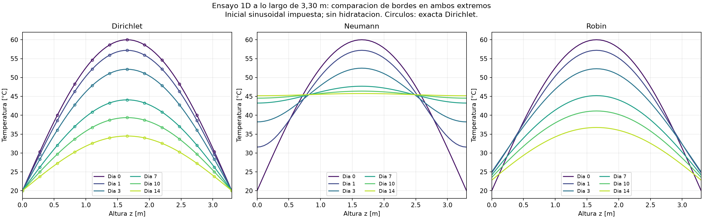
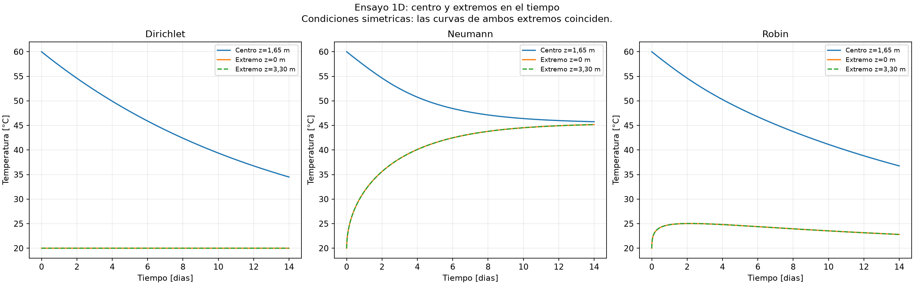

# Gráficos y condiciones para la etapa 1D

## Qué piden los materiales

E01 solicita implementación inicial 1D y explicación de física y bordes. E02
solicita ejecución y modificación de dx/dt. G05 y la guía DIFUSION_DE_CALOR_1D_2D_3D
introducen primero problemas 1D verificables; los campos 3D de G06 corresponden
a una etapa posterior. Los gráficos originales de una barra de 1 m eran un
benchmark válido, pero no recorrían la altura de la fundación.

El nuevo ensayo usa L=3,30 m, leído de geometria_fundacion.json, con coordenada
vertical z y 61 nodos (dx=0,055 m). No transforma una solución 1D en un campo 3D
ni aplica temperaturas de una barra a una imagen de la fundación.

## Ecuación y condiciones

rho*cp*dT/dt = k*d²T/dz² + qdot.

- k=2 W/(m K), rho=2400 kg/m³, cp=900 J/(kg K): valores ilustrativos existentes.
- Inicial: T(z,0)=20+40*sin(pi*z/L) °C, elegida para verificar la difusión.
- Fuente qdot=0: no hay hidratación en estas figuras.
- Tiempo: 0 a 14 días; dt=600 s.
- Se supone una columna de sección constante y sin pérdidas laterales.
- No se representa la geometría octogonal ni la variación de área con altura.
- No se representa aún el suelo, el clima real, las vertidas por etapas o el moldaje.

Tres casos separados sobre el mismo estado inicial:

1. Dirichlet: T(0,t)=T(L,t)=20 °C.
2. Neumann: flujo saliente cero en ambos extremos; energía conservada.
3. Robin: flujo saliente = h*(T-T_amb), h=10 W/(m² K), T_amb=20 °C.
   Son parámetros didácticos para comparar bordes, no meteorología de Punta Arenas.

La inicial sinusoidal no satisface la derivada de los bordes Neumann/Robin en
t=0: los ensayos admiten un ajuste transitorio inmediato de la frontera.
Para verificar esos bordes con iniciales compatibles se usan modos analíticos
específicos en los tests, no solo inspección visual.

## Cómo ejecutar y ver

```powershell
.\.venv\Scripts\python.exe graficos_fundacion_1d.py
.\.venv\Scripts\python.exe -m pytest tests/test_bordes_1d.py -q
```

Abrir resultados/fundacion_1d:

- 01_perfiles_altura.png: temperatura frente a z, días 0/1/3/7/10/14, para cada borde.
- 02_centro_y_extremos.png: temperaturas del punto central y los dos extremos frente al tiempo.
- *_perfiles.csv y *_historia.csv: datos de las curvas.
- parametros_y_resultados.json: supuestos y valores utilizados.

Copias de referencia visibles en GitHub:





## Interpretación de las curvas

Dirichlet: extremos fijos a 20 °C; centro decrece de 60 a ~34,495 °C en 14 días.
Los círculos representan la solución exacta y las líneas el cálculo numérico.
El error máximo final es ~0,0003425 °C. La exacta es
20+40*sin(pi*z/L)*exp(-alpha*(pi/L)²*t).

Neumann: extremos se calientan, centro se enfría; energía total constante.
Al día 14 el centro está a ~45,752 °C y los extremos a ~45,166 °C; todavía no
hay equilibrio completo. A largo plazo tiende a la media inicial (~45,46 °C;
la media discreta trapezoidal difiere ligeramente).

Robin: la superficie empieza a 20 °C, recibe calor del interior y sube, aunque
intercambia con aire a 20 °C. Más tarde se enfría. Al día 14 el centro está a
~36,758 °C y los extremos a ~22,806 °C. Una superficie convectiva no está obligada
a tener la misma temperatura del aire. Ambos extremos coinciden por simetría.

Estos valores son respuestas de los ensayos declarados, no resultados de obra
ni evidencia de que la fundación cumpla 70/20 °C. No estiman el diferencial
reglamentario con puntos a 25 mm bajo la superficie.

## Dónde está cada parte del código

En difusion_1d_bordes.py:

- resolver: recibe geometría 1D, material, tiempos, condición inicial y los dos bordes.
- alpha y tasa: difusividad y comprobación de estabilidad local de interiores y extremos.
- T inicial: evalúa la función inicial en todos los nodos y aplica Dirichlet si corresponde.
- nueva[1:-1]: ecuación del calor discretizada en nodos interiores.
- bloque dirichlet: impone temperatura en el extremo.
- variable q: flujo saliente impuesto o calculado por Robin.
- actualización extrema: balance de energía sobre medio volumen en cada borde.
- pesos: extremos con peso dx/2 para integrar energía por unidad de área [J/m²].

El signo de q es hacia afuera en AMBOS extremos; q positivo enfría el dominio.
La estabilidad interior exige Fo<=0,5. Para Robin, el límite es más restrictivo:
dt*(2*alpha/dx² + 2*h/(rho*cp*dx))<=1. Se rechazan pasos que incumplen el límite.

Los tests comprueban Dirichlet exacto, un modo Neumann exacto y conservación,
fuente uniforme adiabática, flujo saliente y balance, un modo Robin analítico,
Robin con h=0 equivalente a adiabático, estabilidad y snapshots a tiempos exactos.

No se requiere PyVista/VTK para estos ensayos: NumPy y Matplotlib bastan.
