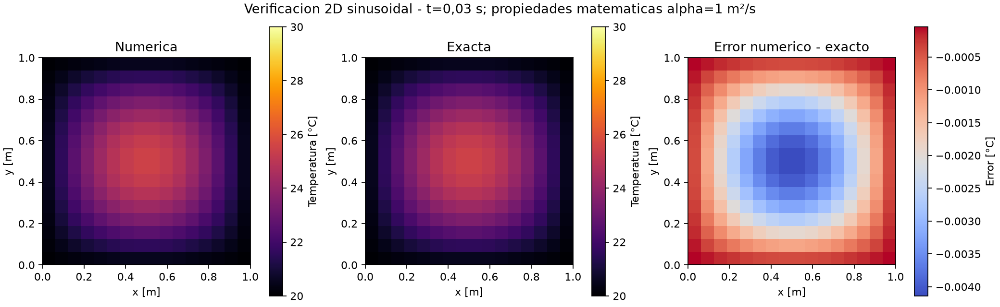
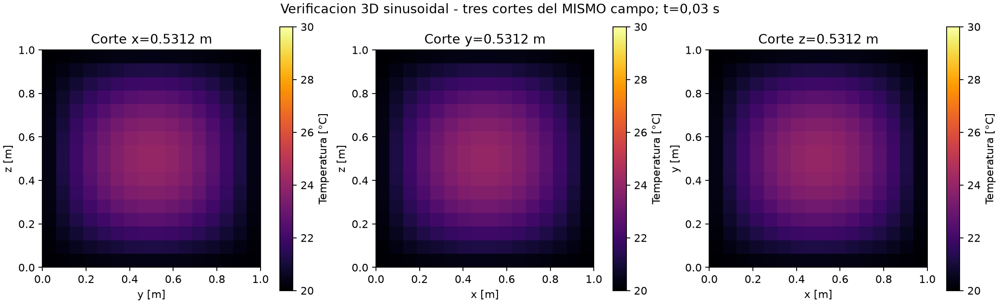
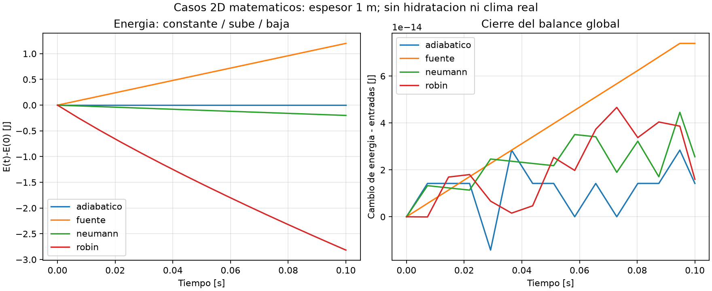
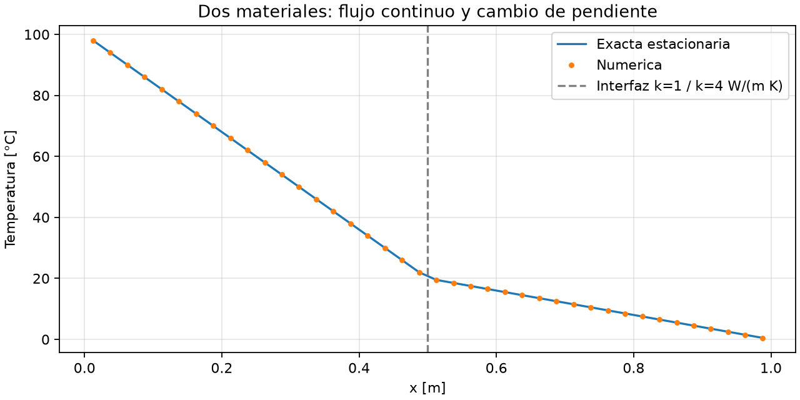
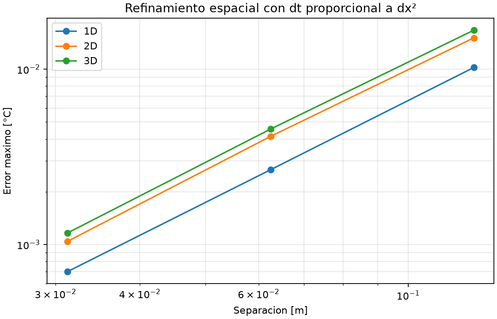

# Semana 2: solver general y batería de verificación

## Alcance

Implementación propia en termico_cartesiano.py para 1D/2D/3D. No depende de
Blender, no copia un modelo FE y no incorpora hidratación ni clima real.
casos_verificacion.py define soluciones conocidas y demo_semana2.py genera
figuras, tablas y campos completos. tests/test_cartesiano.py verifica el mismo
motor que ejecuta la demo. Los módulos 1D anteriores se conservan.

El BIM del caso base está en modelo_e02.ifc: fundación provisional octogonal
18 × 18 m, altura total 3,30 m y cilindro superior de diámetro 7 m. La transición
y el plan de tres capas requieren validación docente (GEOMETRIA_FUNDACION.md).
Esta batería se resuelve en dominios matemáticos, no es una predicción térmica
de esa fundación. La conexión térmica al IFC y la activación dinámica son posteriores.

## Comandos para la actividad

Desde la raíz del proyecto, en la terminal de VS Code:

```powershell
.\.venv\Scripts\python.exe -m pytest tests/test_cartesiano.py -v
.\.venv\Scripts\python.exe demo_semana2.py
```

El primer comando ejecuta 23 pruebas del motor general. Para incluir la batería
1D previa y el lector IFC:

```powershell
.\.venv\Scripts\python.exe -m pytest -q
```

Demostración individual de 3D, cambio de resolución y paso inválido:

```powershell
.\.venv\Scripts\python.exe demo_semana2.py --caso sinusoidal_3d --n 16 --salida resultados/demo_3d
.\.venv\Scripts\python.exe demo_semana2.py --caso sinusoidal_3d --n 32 --salida resultados/demo_3d_fino
.\.venv\Scripts\python.exe demo_semana2.py --caso sinusoidal_3d --n 16 --dt 0.1
```

El tercero debe detenerse con error de estabilidad, no producir temperaturas
explosivas. El modelo rechaza el dt solicitado en lugar de corregirlo silenciosamente.

## Dónde ver los resultados

En resultados/semana2:

| Archivo | Qué muestra |
|---|---|
| sinusoidal_2d.png | Campo numérico, exacto y error en la placa |
| sinusoidal_3d.png | Tres cortes ortogonales del mismo campo tridimensional |
| campo_2d.npz, campo_3d.npz | Temperatura, exacta, error y coordenadas en TODO el dominio |
| convergencia_1d_2d_3d.png | Error al refinar cada dimensión |
| convergencia.csv | Resoluciones, pasos temporales y errores |
| balances_y_bordes.png | Energía con aislación, fuente, flujo y convección; residual |
| balance_*.csv | Cambio de energía, entrada neta y cierre del balance |
| dos_materiales.png | Cambio de pendiente y continuidad del flujo en interfaz |
| resumen.json | Parámetros matemáticos, errores, balances y commit |

Los tiempos cortos y alpha=1 m²/s de los benchmarks son elecciones matemáticas
para verificar rápidamente: NO propiedades del hormigón ni condiciones de Punta Arenas.

## Balance de un voxel: qué escribir y explicar

Para una celda i de volumen V_i:

**C_i dT_i/dt = suma_j[G_ij(T_j-T_i)] + qdot_i V_i + P_borde_i**

C_i = rho_i cp_i V_i, en J/K. Cada término derecho es una potencia [W].
Un vecino más caliente aporta potencia positiva; uno más frío aporta negativa.
El intercambio interno se calcula una sola vez y se suma a una celda y se resta
a la otra. Esto conserva energía también cuando los materiales son diferentes.

En 1D, el área transversal implícita es 1 m². En 2D se supone espesor 1 m.
En 3D se usa volumen dx*dy*dz real. El campo T está en centros de celda; no
confundirlo con el esquema nodal de solver_1d.py ni con la temperatura de la cara.

## Derivación de estabilidad

Euler explícito usa únicamente temperaturas del instante anterior:

T_i_nueva = T_i + dt/C_i * [suma_j G_ij(T_j-T_i) + qdot_i V_i + P_borde_i].

Para los bordes lineales P_borde = b_i - G_bi*T_i, el coeficiente de T_i es:

**1 - dt*(suma_j G_ij + G_bi)/C_i**.

Exigir coeficientes no negativos da una condición suficiente de monotonía:

**dt <= min_i C_i/(suma_j G_ij + G_bi)**.

El programa construye esa suma local y rechaza dt mayores. Para celdas interiores
homogéneas e isotrópicas, se obtiene:

- 1D: alpha*dt/dx² <=1/2.
- 2D: alpha*dt/dx² <=1/4.
- 3D: alpha*dt/dx² <=1/6.
- Espaciamientos distintos: alpha*dt*sum_a(1/d_a²)<=1/2.

El borde puede imponer un límite menor. En esta implementación centrada en
celdas, Dirichlet actúa a media celda: su conductancia vale 2*k*A/d. En una
esquina puede hacer más restrictivo el límite que el criterio de un nodo interior.
No copiar sin revisión Fo<=1/6 como condición suficiente para todos los bordes.
La fuente es prescrita e independiente de T; una cinética dependiente de T
requeriría otro análisis de estabilidad.

## Bordes: implementación, flujo y signos

Los nombres son x-, x+, y-, y+, z-, z+. Los no declarados se consideran
Neumann adiabático. En dominios con máscara, la regla por orientación se aplica
también a las caras expuestas frente a celdas inactivas. No modela todavía suelo
por ubicación ni una secuencia de activación cambiante durante la corrida.

**Dirichlet:** temperatura Tb prescrita en la CARA. El centro se calcula:
P = (k*A/(d/2))*(Tb-Ti). No se impone Ti=Tb al centro.

**Neumann:** flujo normal q'' positivo hacia afuera, en W/m².
P_entrante = -q''*A. q''=0 significa adiabático. Vale el mismo signo saliente
para las caras positivas y negativas de los ejes.

**Robin:** P_entrante=G_b*(T_amb-Ti), con
G_b=A/[d/(2*k)+R+1/h]. h está en W/(m² K), R en m² K/W.
Incluye resistencia conductiva de media celda más la convección y una resistencia
opcional de moldaje/aislación. h=0 equivale a adiabático. Si Ti>T_amb, se enfría.
T_amb constante es un parámetro de benchmark, no un pronóstico meteorológico.

Ejemplo de API:

```python
from termico_cartesiano import TermicoCartesiano

modelo = TermicoCartesiano(
    forma=(12, 12, 8), longitudes=(1., 1., 1.),
    k=2., rho=2400., cp=900.,
    bordes={
        "z+": {"tipo": "robin", "h_W_m2K": 10., "temperatura_C": 20.},
        "z-": {"tipo": "neumann", "flujo_saliente_W_m2": 0.},
        "x-": {"tipo": "dirichlet", "temperatura_C": 20.},
    },
)
resultado = modelo.resolver(
    inicial=30., duracion_s=3600., dt_s=min(60., .8*modelo.dt_max),
    fuente_W_m3=100.,
)
```

Los números de este ejemplo son ilustrativos; el flujo de los casos automáticos
se configura en demo_semana2.py. Las propiedades y fronteras son constantes
durante cada corrida de esta versión; no se deben mutar después de construir
el modelo porque las conductancias ya están precalculadas.

## Fuente volumétrica versus flujo superficial

- qdot [W/m³] actúa dentro del material. Multiplicar por volumen para obtener W.
- q'' [W/m²] cruza una superficie. Multiplicar por área para obtener W.
- Un flujo convectivo no se agrega como fuente en todo el volumen.
- En un dominio adiabático con fuente uniforme: T(t)=T0+qdot*t/(rho*cp).

En los tests se usa una fuente uniforme controlada, no hidratación. Por eso se
conoce exactamente el aumento lineal y la energía que debe acumularse.

## Dos materiales

En una interfaz entre celdas iguales:

k_efectivo = 2*k_i*k_j/(k_i+k_j).

La media armónica representa dos resistencias de media celda en serie.
El flujo debe ser continuo; la pendiente puede cambiar porque q=-k*dT/dx.
El test usa k1=1 y k2=4: el material menos conductor tiene mayor gradiente.
No es correcto usar siempre la media aritmética ni promediar temperaturas sin
considerar las capacidades térmicas.

## Qué comprueba cada familia de tests

| Caso | Evidencia |
|---|---|
| Sinusoidal 1D/2D/3D | Exacta T=20+10*producto sin(pi*x_a/L_a)*exp(-alpha*pi²*sum(1/L_a²)*t) |
| Refinamiento espacial | Al duplicar n, el error disminuye aproximadamente por factor 4 |
| Refinamiento temporal | Comparación con solución exacta del sistema espacial, para aislar el error de Euler |
| Adiabático | Energía constante desde un campo inicial no uniforme |
| Fuente uniforme | Aumento lineal conocido y energía qdot*V*t |
| Neumann | Flujo saliente enfría y pérdida total coincide con q''*A*t |
| Robin | Modo analítico de pared con mu*tan(mu)=h*a/k; otras direcciones aisladas |
| Dos materiales | Perfil estacionario con flujo continuo y resistencia en serie |
| Balance global | DeltaE coincide con la integral de fuente más bordes |
| Máscaras | No hay conducción entre componentes desconectados |

La comparación exacta de los sinusoidales muestra orden global próximo a dos
cuando dt es proporcional a dx²; no se presenta como un estudio espacial puro.
El test temporal usa la solución exacta del operador espacial discretizado.

## Dónde mostrar el código durante la revisión

- __init__: grilla, capacidad térmica, pares de vecinos, fronteras y dt_max.
- potencias: balance energético y cancelación de flujos internos.
- paso: Euler explícito con chequeo de estabilidad.
- resolver: integración temporal, snapshots y balance global.
- tests/test_cartesiano.py: aserciones numéricas y soluciones de referencia.
- modelo_e02.ifc: abrir en Bonsai, identificar fundación y tres vertidas.

## Método de Schmidt: sección revisada del Anexo 4

Se revisaron las páginas impresas 25–26 (páginas 21–22 del PDF) de la especificación
ICH de julio de 2019. Expone diferencias finitas en posiciones y tiempos discretos.
Para su caso simplificado aparece dt=dx²/(2*alpha), que en difusión 1D uniforme
corresponde a Fo=1/2: el término central desaparece y la temperatura nueva es
el promedio de los dos vecinos. El desarrollo adiabático se incorpora como
aporte adicional cuando existe hidratación; no se usa en los benchmarks actuales.

El texto permite extender la metodología a más dimensiones y advierte que las
condiciones de borde pueden determinar los resultados. Nuestro balance por
conductancias conserva esa filosofía, pero generaliza materiales, fronteras y
paso temporal: no se presenta como reproducción literal del anexo.

Cada integrante debe leer el original. Fuente editorial:
https://ich.cl/documentos-ich/especificacion-para-hormigon-masivo-estructural/
Copia consultada en el catálogo CChC:
https://catalogo.extension.cchc.cl/documentos/documentos/43106-2.pdf

## Figuras de referencia para revisar desde GitHub











## Preguntas orales que deben practicar

1. Escribir C_i*dT/dt y convertir cada aporte a W.
2. Obtener dt_max haciendo no negativo el coeficiente de Ti.
3. Indicar signo de un flujo normal saliente y de la convección con aire frío.
4. Identificar cara adiabática y explicar por qué T puede variar aun con q''=0.
5. Separar generación interna de intercambio superficial.
6. Justificar media armónica en la interfaz.
7. Explicar que aislación cambia la resistencia y puede retener calor: no siempre
   mejora simultáneamente Tmax y diferencial.
8. Mostrar una prueba exacta y otra de conservación, no solo una figura suave.
