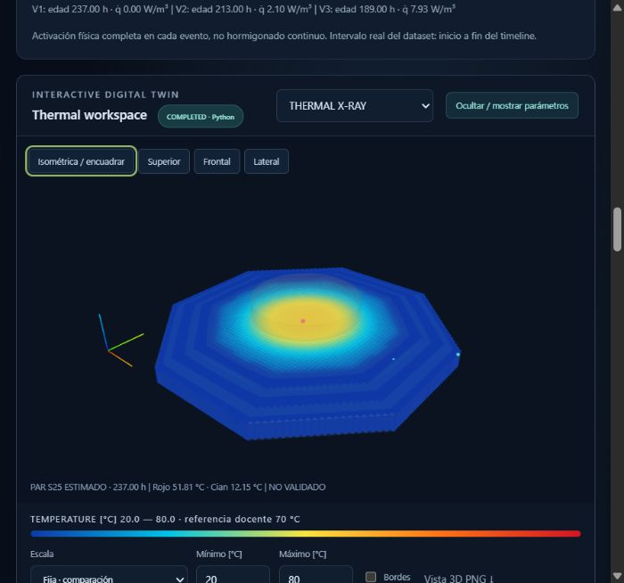

# THERMA — Auditoría final S25 IFC (16 noviembre 2026)

## Conclusión y alcance

**S25 IFC: NOT VALIDATED. Criterio de 20 °C: INDETERMINATE.** Se reejecutó Propuesto/M4_SS FV/Tikhonov en tres mallas durante 336 h. Se conservaron geometría, parámetros, clima y cronograma. No se rellenaron temperaturas desconocidas, no se alteró el motor físico ni se reejecutó la tabla de planes.

La auditoría identifica causas y errores concretos, no demuestra todavía una cota de error térmico para la fundación. La cobertura de cuadratura y la reproducción exacta de polinomios son comprobaciones necesarias, insuficientes para certificar S25.

## 1. Puntos desconocidos

| Objetivo XY | Paso Z real | Desconocidos finales | Área de cuadratura calculada (incluye base) | Área aire calculada | Área inclinada calculada |
|---|---|---:|---:|---:|---:|
| 500 mm | 471,429 mm | 0 / 6048 | 100 % | 100 % | 100 % |
| 375 mm | 366,667 mm | 24 / 6048 | 99,079 % | 98,397 % | 97,519 % |
| 250 mm | 235,714 mm | 88 / 6048 | 96,213 % | 93,410 % | 89,802 % |

Todos los faltantes pertenecen a la **Vertida_02**, en su zona inclinada y delgada próxima a la interfaz con Vertida_01. Aparecen después de activarse V2 y persisten tras V3: 24/88 son puntos únicos, no deben sumarse los registros de los dos estados. El CSV conserva cada estado por separado.

- **Causa directa:** centros vecinos coplanares, rango afín 3 cuando se necesitan 4 coeficientes. La extensión Z del conjunto es exactamente cero. Ejemplos: 47 vecinos en 375 mm y 52 en 250 mm, incluso con radio de seis celdas. No es escasez del número de vecinos; falta información en una dirección.
- **Causa geométrica:** la representación staircase de una parte delgada de V2 sólo deja una altura de centros dentro del stencil unilateral. El stencil excluye otras vertidas para no mezclar temperaturas de hormigón fresco con existente.
- **Normales:** todas las normales auditadas son unitarias; el desplazamiento es 0,025 m; el probe exterior queda fuera de la unión activa.
- **Pertenencia:** todos los puntos faltantes están dentro del hormigón activo; no son puntos exteriores ni vóxeles inactivos.
- **Aristas:** distancias de las muestras superficiales auditadas a aristas físicas/facetadas entre 0,00952 y 0,29434 m. La proximidad es relevante, pero el defecto algebraico común es la coplanaridad.
- **Interfaces:** no son caras internas erróneamente tratadas como aire; son superficies exteriores de V2 cuya vecindad está condicionada por la interfaz. Las interfaces cubiertas se excluyen según la unión activa.
- **Por qué 500 mm parece mejor:** seis celdas abarcan más metros, alcanzando zonas gruesas. Cobertura completa con ajuste amplio no implica mayor precisión; su punto crítico sólo admite ajuste lineal y tiene RMSE 1,214 °C.

No se amplió arbitrariamente el radio ni se cruzaron interfaces para ocultar el problema. Dos campos T=20 y T=20+b(z-z0) coinciden en todos los centros de un plano z0 y difieren fuera de él: ninguna reconstrucción basada únicamente en esos valores puede determinar b. Se requiere información adicional físicamente consistente (frontera/interfaz conforme o refinamiento conservativo), no rellenar con el vecino más próximo.

`diagnostico_desconocidos.csv` registra rango, vecinos, extensión espacial, normal, pertenencia, área, distancia a aristas y diagnóstico. `cobertura_superficies.csv` separa estado constructivo, aire/suelo y horizontal/lateral/inclinada. El área es la suma de las subcaras de cuadratura representadas por las muestras; no certifica cobertura continua ni el mínimo entre muestras.

## 2. Par crítico Propuesto/M4_SS, malla 250 mm

Máximo del diferencial **estimado y parcial** sobre todos los pasos observados:

- t = **853200 s = 237 h = 9,875 días** desde inicio.
- Tmax del hormigón activo en ese paso = **51,8066114357 °C**.
- Centro caliente XYZ = **(-0,125; -0,125; 1,5321428571) m**, índices Python **(35,35,6)**, Vertida_02.
- Tmin S25 reconstruida simultánea = **12,1529080978 °C**.
- Punto S25 XYZ = **(8,8237498503; 3,8688428516; 0,7333333333) m**, Vertida_01.
- ΔT estimado = **39,6537033379 °C**. No confundir con Tmax temporal de toda la corrida, que es 53,3842377305 °C y ocurre en otro instante.
- Superficie asociada = (8,8414289678; 3,8865190731; 0,7333333333) m.
- Distancia euclídea mínima a la superficie exterior IFC = **0,025 m**, comprobada separadamente del desplazamiento normal. Triángulo **27 (desde cero)** de V1, GUID **05tuyNv2v7FvuEWPDu$NI8**.
- Normal exterior = (0,7071646986; 0,7070488590; 0).
- Frontera: aire Robin en caras cartesianas x+ y y+, h=10 W/(m² K), aire=8,2 °C en ese paso, moldaje e/k=0,1333333333 m² K/W; R adicional=0. No es contacto con suelo ni interfaz interna.
- Método: MLS cuadrático unilateral, **36 centros** de V1; radio 2 celdas; condición 25,537; suma de pesos absolutos 3,90458; error de reproducción polinómica 9,30e-16.
- RMSE del ajuste a centros = **0,152112 °C**, máximo residuo=0,342967 °C. **Ninguno es cota del error respecto de la solución física.**
- Centro disponible más cercano a S25 a 0,218957 m; distancia de la muestra superficial a una arista de cambio de plano=0,224272 m. La reconstrucción extrapola desde centros interiores hasta S25, dentro de la geometría, y debe justificarse con los benchmarks.

El punto frío mantiene el mismo índice durante ±1 h; el mayor cambio de ΔT entre pasos vecinos de esa ventana es 0,007498 °C. El evento de colocación más próximo ocurrió 189 h antes. No hay interpolación temporal: se conserva el campo del **paso exacto** de máximo diferencial y su máscara activa. Esto descarta un salto de snapshot/activación en el máximo, **no descarta el error de frontera o reconstrucción**.

`case_02_critical_pair.json` contiene también coordenadas del triángulo, stencil completo, pesos, temperaturas de vecinos y ventana temporal. `case_02_critical_neighbors.csv` permite reproducir el producto pesos·temperaturas. El campo exacto está en `resultados/validacion_s25_final/estudio/case_02/s25_ifc_critical.npz` y también se inserta en los snapshots temporales exportados, sin cambiar la integración.

## 3. Referencias: errores separados

Todos los errores siguientes corresponden a sus casos de control, **no son cotas transferibles al IFC**.

| Caso | Resoluciones | Error máximo S25 [°C] | Qué demuestra |
|---|---|---|---|
| Cubo, difusión sinusoidal, Dirichlet | n=6 / 10 / 16 | 0,305195 / 0,083721 / 0,021050 | Campo FV + reconstrucción convergen en este caso alineado |
| Cubo, modo exacto Robin con R=0,2 | n=6 / 10 / 16 | 0,096236 / 0,026929 / 0,007201 | Ídem con resistencias |
| Plano inclinado, campo cuadrático conocido | n=6 / 10 / 16 | < 4,3e-14 | Reproducción MLS; no valida sus flujos FV |
| Cilindro facetado, campo cuadrático conocido | n=6 / 10 / 16 | < 7,9e-14 | Reproducción en geometría curva facetada; no valida la PDE curva |
| Cerca de esquina, campo cuadrático | n=6 / 10 / 16 | < 6,1e-14 | Reproducción unilateral de campo suave |
| Plano Robin alineado, campo estacionario lineal | n=12 / 24 / 48 | < 2,2e-14 | Balance y reconstrucción en referencia alineada |
| Plano Robin inclinado 45°, staircase | n=12 / 24 / 48 | 0,881797 / 0,603360 / 0,475101 | Error físico de frontera aunque MLS sobre campo exacto sea exacto |
| Perfil erf, gradiente fuerte de 50 mm | Δ=250 / 125 / 62,5 / 31,25 mm | 23,940822 / 18,211795 / 2,301244 / 0,188783 | Un ajuste sin resolución suficiente puede ocultar una excedencia |

Los errores totales de los casos sinusoidales separan error de reconstrucción sobre centros exactos y propagación del error FV en `errores_referencia.csv`. El caso de cilindro usa la triangulación, no una superficie CAD circular exacta. El estudio previo de faceteado está en `docs/s25_ifc/evidencia/error_geometrico_cilindro.csv`.

### Frontera escalonada: problema demostrado

Benchmark: plano exacto Robin, k=1, h=4, q=10, Tamb=20 ⇒ Ts=22,5 y S25=22,75 °C. Los bordes lejanos usan la solución analítica. Se reutiliza `TermicoCartesiano.paso()`; no se crea otro integrador. Se verifica residual estacionario y conservación energética.

Para plano inclinado, el área aire staircase es 2,0 frente a 1,466539 m² reales, razón 1,36375. En n=48 el flujo calculado es 15,60023 frente a 14,66539 W exactos (6,37 % alto); el error S25 sigue siendo 0,47510 °C. La reconstrucción de centros analíticos tiene error <3e-14: por lo tanto no es un fallo de MLS en ese campo, sino de la representación física de frontera. Conservar energía no garantiza intercambiar calor con el área física correcta.

Una variante de **benchmark solamente** pondera área y conserva h físico: error S25 0,153396 / 0,010885 / 0,055802 °C; no es monótono, y corregir área por sí sola tampoco resuelve posición/resistencia. **No se aplica esa corrección experimental a la fundación.** Para el plano lateral crítico IFC, Σ|n_a|≈1,41421 señala el problema de área de las caras cartesianas. Es una observación geométrica, no una cota de error térmico de 41 % ni una corrección autorizada de h.

### Gradiente pronunciado: falso cumplimiento de control

Perfil exacto de difusión en semiespacio T=20+50 erf(x/0,05). A 25 mm T=46,024994 °C y, tomando Tmax=70, ΔT verdadero=23,975006 °C. Con centros separados 250 mm, MLS predice 69,965816 °C ⇒ ΔT aparente=0,034184 °C. El campo es matemático de referencia, **no representa una predicción de la fundación**. Demuestra por qué no se puede usar RMSE, condición del ajuste o parecido entre tres mallas como certificado universal.

## 4. Comparación de la fundación

| Malla XY/Z [mm] | Celdas activas finales | Volumen [m³] | Error volumen IFC | Tmax temporal [°C] | ΔT estimado parcial [°C] | Hora ΔT | Tiempo solver medido [s] |
|---|---:|---:|---:|---:|---:|---:|---:|
| 500 / 471,429 | 4124 | 486,042857 | 0,2108 % | 53,949719 | 39,384873 | 239 | 14,90 |
| 375 / 366,667 | 9388 | 484,068750 | 0,6161 % | 53,560270 | 40,144239 | 238 | 13,40 |
| 250 / 235,714 | 32912 | 484,864286 | 0,4528 % | 53,384238 | 39,653703 | 237 | 24,46 |

El IFC usado tiene 487,069524 m³, se mantiene provisional y no se modifica en esta tarea. Menor tamaño de celda no garantiza error de volumen monótono. El paso temporal usado es 900 s, constante y estable para las tres corridas; misma física en todas. El residual energético relativo es ≤1,49e-15. Son tiempos medidos en este equipo, no predicciones universales de costo. Los tamaños Z se ajustan a la caja; las mallas no son isotrópicas exactas.

La diferencia de ΔT entre 375 y 250 mm es -0,490536 °C, **no una cota de error**. Cambia el soporte espacial de los stencils, algunas reconstrucciones son lineales y otras cuadráticas; la familia no ha demostrado converger a la frontera IFC física.

## 5. Dos preguntas distintas

A. ¿Existe al menos un testigo validado que demuestre ΔT>20? **No demostrado aún.** El testigo estimado es 39,6537 °C, pero no hay cota validada que incluya error de campo, frontera y reconstrucción. No basta con observar el margen de 19,6537 °C.

B. ¿Se pueden descartar todas las excedencias? **No.** Hay puntos sin soporte, cuadratura superficial finita y no hay cota global de error espacio/tiempo.

`therma/criterio_s25.py` implementa esta asimetría: basta un testigo con (ΔT−error)>20 para rechazar, aun con cobertura parcial. Para aprobar requiere cobertura relevante completa y una cota superior global validada ≤20. No transforma una estimación o residuo de ajuste en una cota. Las probabilidades y la tabla de planes siguen INDETERMINADAS respecto a S25.

## 6. Cómo verlo y reproducirlo

Desde PowerShell en la carpeta del proyecto:

```powershell
.\.venv\Scripts\python.exe construir_panel.py
.\.venv\Scripts\python.exe servidor_therma.py --port 8767
Start-Process 'http://127.0.0.1:8767/panel_termico.html'
```

En **Laboratorio térmico → Cargar ajustes ↑**, cargar `docs/s25_final/evidencia/case_02_config.json`. El panel ejecuta Python. Si se solicita ejecutar, presionar Ejecutar simulación. Esperar COMPLETED. En el visor pulsar **VER PAR CRÍTICO S25 · ESTIMADO**. El timeline va al paso exacto 237 h, abre un corte Z y muestra rojo=Tmax y cian=S25. Los marcadores se dibujan sin oclusión para localizarlos: no son temperaturas de vóxeles adicionales. El cuadro adjunto incluye coordenadas, triángulo y estado NO VALIDADO. Si cambia el instante, los marcadores críticos se ocultan; el botón vuelve al instante de referencia. Un resultado antiguo sin campo exacto no habilita el botón.

```powershell
.\.venv\Scripts\python.exe estudiar_malla_s25.py --resoluciones 0.5 0.375 0.25 --salida resultados/validacion_s25_final/estudio
.\.venv\Scripts\python.exe casos_frontera_staircase.py
.\.venv\Scripts\python.exe auditar_s25_final.py
.\.venv\Scripts\python.exe -m pytest -q
```

Las tablas y metadatos compactos se conservan en `docs/s25_final/evidencia`; campos grandes en `resultados/validacion_s25_final`. `SHA256.json` identifica artefactos. Las configuraciones conservan fuentes, clima y propiedades; hashes de código de las corridas están en sus metadatos. SHA base Git: 12edb005f4d94ab1428b3792a284886c0e9f8dbf; esta entrega tiene cambios locales posteriores y no constituye un commit nuevo.

## 7. Recomendación y trabajo pendiente

Usar **250 mm para exploración de Tmax y localización**, 500 mm sólo para ensayos rápidos. **Ninguna de las tres resoluciones certifica S25.** No recomendar una malla de 25 mm global ni aprobar el plan por su cobertura a 500 mm.

Siguiente mejora física prioritaria: representación conservativa de flujos sobre las caras IFC inclinadas (área, posición y distancia normal), y cierre de reconstrucción con restricciones consistentes de frontera/interfaz o refinamiento local verificado. Validar primero en plano inclinado, cilindro y encuentros de vertidas, con campos no polinómicos y gradientes fuertes; después establecer cotas/errores de clasificación en la fundación. No corregir parámetros materiales o h para forzar cumplimiento.

Explicación para defensa: «Los vóxeles calculan temperaturas en sus centros. Para medir S25 tomamos puntos a 25 mm hacia dentro de los triángulos IFC y reconstruimos el campo desde centros activos de la misma vertida. Si esos centros están en un solo plano, falta información y dejamos el punto desconocido. Además verificamos que el borde escalonado no cambie el flujo físico: encontramos un error pendiente. Por eso mostramos el diferencial como estimación y aún no certificamos el límite.»

## 8. Archivos de esta entrega

Nuevos: `therma/auditoria_geometrica.py`, `therma/criterio_s25.py`, `casos_frontera_staircase.py`, `auditar_s25_final.py`, `tests/test_validacion_final_s25.py`, este documento y `docs/s25_final/evidencia/*`.

Modificados: `therma/superficies_ifc.py` (entrada de puntos robusta), `therma/reconstruccion_s25.py` (diagnóstico por stencil), `therma/s25_ifc.py` (auditoría/áreas/par crítico), `therma/ejecutar.py` y `therma/construccion.py` (guardar snapshot observado exacto sin alterar integración), `tests/test_s25_ifc_resolucion.py`, `panel/visor.html`, `panel/visor3d.js`, `panel/visordatos.js`, `panel_termico.html` regenerado, `README.md`, `.gitattributes`. No se sustituyó ni borró trabajo local anterior. No se modifica `termico_cartesiano.py` en esta tarea.


## 9. Verificación ejecutada

- Pruebas focales de S25: **40 aprobadas en 24,45 s** (antes de añadir la comprobación JS del par crítico).
- Regresión final completa: **316 aprobadas en 66,45 s**.
- La primera ejecución completa tuvo 315 aprobadas y un aborto de conexión Windows 10053 en el test preexistente de rechazo de Origin. El test pasó aislado y la segunda batería completa pasó sin cambios en ese servidor/test. Se registra la incidencia; no se ocultó ni se relajó la validación de origen.
- Comprobación real en navegador: Propuesto/M4_SS de 250 mm, COMPLETED, botón par crítico ⇒ 237 h, 51,8066/12,1529 °C y distancia IFC 25 mm. Escenarios locales guardados anteriores se conservaron.
- La observación S25 no altera temperaturas ni balance: comparación exacta de todos los snapshots comunes con/sin observador. Sólo añade el campo del instante crítico a la exportación.
- Distancia mínima vs desplazamiento normal, exclusión de interfaces, diagonales coplanares, rango insuficiente, criterio asimétrico, caso staircase y falso cumplimiento de perfil pronunciado se verifican automáticamente.


