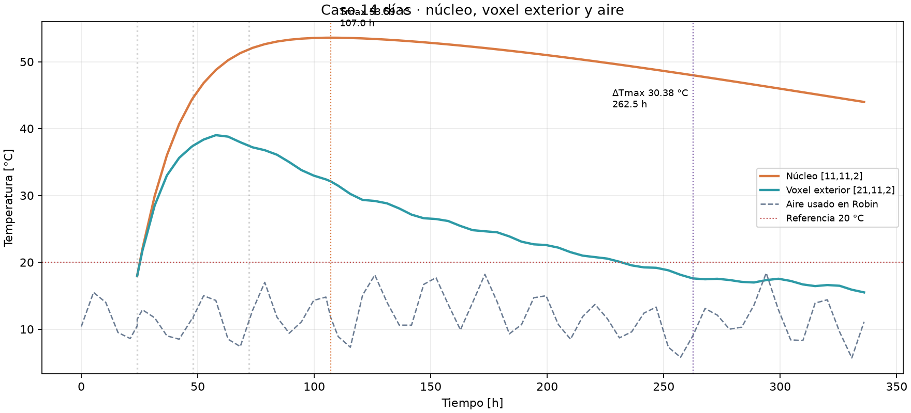
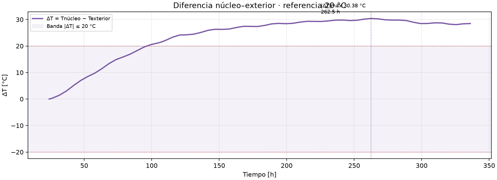
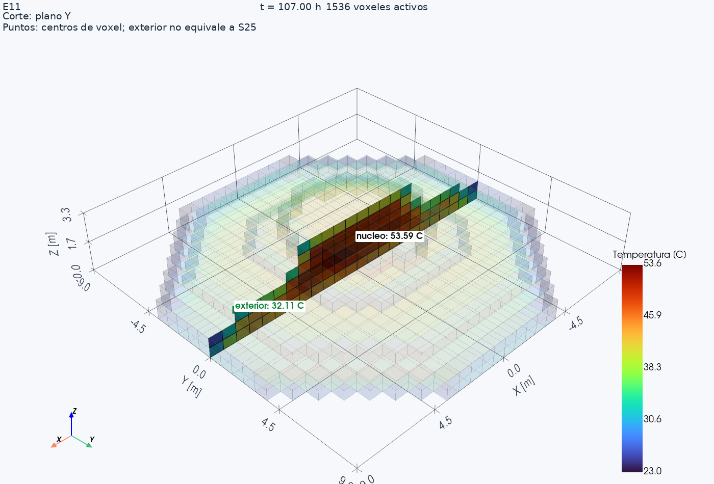
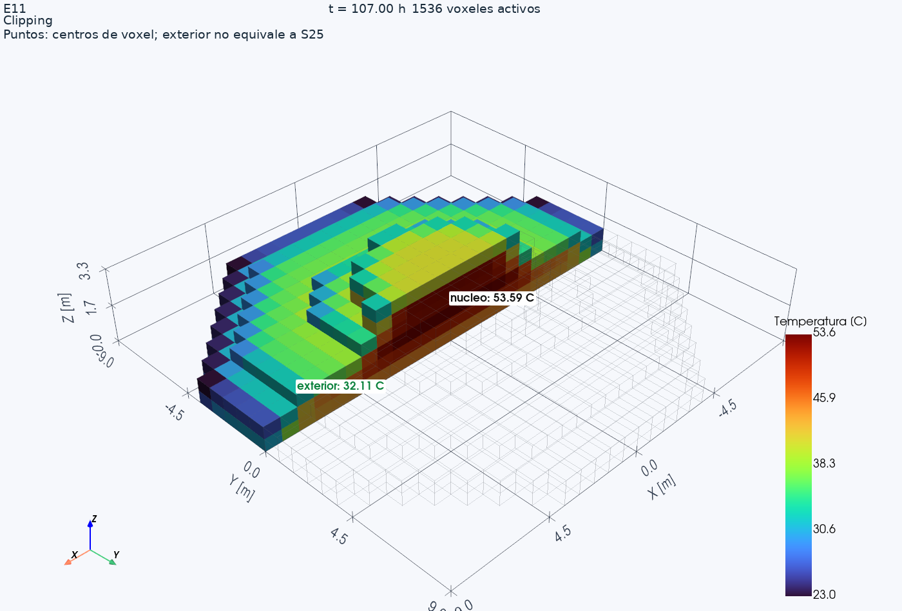

# Entrega E11 · Caso completo de 14 días

> **Corrección disponible:** con la protección térmica didáctica del panel (e=0.20 m, k=0.15, caras x±/y±/z+), el ΔT núcleo–exterior baja a **15.27 °C**. Ver [`../entrega_14d_corregida/ENTREGA_14D_CORREGIDA.md`](../entrega_14d_corregida/ENTREGA_14D_CORREGIDA.md).

## 1. Repositorio y commit

- Repositorio: `https://github.com/Santiago411323/Proyecto_2_MCOC`
- Commit base: `b0e72c1d9adef5e14177d9cbe95bb5fec4449071` (`E11: conectar clima real y exportar simulacion 3D a VTK`)
- Estado: la corrida se ejecutó con `working_tree_dirty=true` porque el panel fue regenerado y se añadió la serie normalizada `weather_para_panel.json`. El motor y la configuración térmica corresponden al commit indicado.
- IFC: `modelo_e02.ifc`, SHA-256 `feda957981546ce29aa707304675d13e039fd2826dcad0b7c5f342299c9b893e`.
- Evidencia completa: carpeta `docs/e11/entrega_14d/`; datos crudos en `resultados/e11_14d/20261112T210901309516Z/`.

## 2. Forecast, dataset y timestamp

Se usó el snapshot archivado de Open-Meteo:

- Producto: `forecast` (no observación de estación).
- Descarga: `2026-11-12T12:43:25.279292Z`.
- Archivo crudo: `forecast.json`, SHA-256 `3a6a828efa343ee586a3a8e211475decb13678c6a8227d700316f2875d1c5dab`.
- Coordenadas solicitadas: `-52.82177, -70.89685`.
- Coordenadas devueltas por la grilla: `-52.829525, -70.91934`.
- Cobertura: 384 h, desde `2026-11-12T00:00:00Z` hasta `2026-11-27T23:00:00Z`.
- Variable usada en la física: `temperature_2m` (°C). `wind_speed_10m` se archiva, pero no se convierte en `h`; no se usa radiación.
- Inicio de simulación: `2026-11-12T10:00:00-03:00` = `2026-11-12T13:00:00Z`.
- Fin: `2026-11-26T13:00:00Z` (336 h después).

## 3. Tratamiento del horizonte no cubierto

No hubo horizonte no cubierto. La simulación pidió **336 h** y el forecast dispone de **384 h**. El forzante verifica que `times[0] <= 0` y `times[-1] >= duración`; si no se cumple, el solver rechaza la corrida. La política es `missing_policy=reject`: no se rellenan huecos ni se extrapola. La temperatura se mantiene constante por intervalo horario y el último punto es el extremo de cobertura.

## 4. Condiciones de borde

Geometría: fundación IFC voxelizada, malla `24×24×6`, paso `0.75×0.75×0.55 m`, **1.536 celdas activas**, volumen **475.2 m³**. Material: `k=2 W/(m·K)`, `ρ=2400 kg/m³`, `cp=900 J/(kg·K)`, `α=9.259×10⁻⁷ m²/s`. Estado inicial: **20 °C uniforme**.

| Cara | Tipo | Temperatura | h [W/(m²·K)] | R [m²·K/W] | Comentario |
|---|---|---|---:|---:|---|
| x−, x+, y−, y+ | Robin aire | `T_aire(t)` del forecast | 10 | 0.1333 | Moldaje 20 mm, `k=0.15`; `R=e/k` |
| z+ | Robin aire | `T_aire(t)` del forecast | 10 | 0 | Sin moldaje |
| z− | Robin suelo | 8 °C | 1.5 | 0.05 | Reservorio basal; no usa el forecast |

La serie completa varía entre **4.5 °C y 19.3 °C**; en la ventana de 336 h usada por el solver, entre **5.6 °C y 19.3 °C**. El suelo es un reservorio efectivo a 8 °C, con `L=1 m`, `k_s=1.5 W/(m·K)` y `R_contacto=0.05 m²·K/W`; no tiene capacidad térmica ni voxeles de suelo. El moldaje lateral tiene resistencia fija y no se retira.

## 5. Plan de vertidas

| Vertida | ID | Inicio | Colocación | θ∞ | τ |
|---|---:|---:|---:|---:|---:|
| Vertida_01 | 1 | 0 h | 18 °C | 40 °C | 24 h |
| Vertida_02 | 2 | 24 h | 18 °C | 40 °C | 24 h |
| Vertida_03 | 3 | 48 h | 18 °C | 40 °C | 24 h |

La activación es instantánea en el horario indicado; no se modela hormigonado continuo. Cada vertida tiene su propio reloj de edad. La hidratación es exponencial adiabática, didáctica y **no calibrada experimentalmente**. No hay fuente volumétrica adicional: `source=none`, `qmax=0`.

## 6. Resultados térmicos

Simulación: 14 días, 70 snapshots, `Δt=2160 s`, 706 pasos, runtime **0.254 s**. Residual energético relativo: **1.02×10⁻¹⁵**.

| Métrica | Valor | Tiempo | Ubicación |
|---|---:|---:|---|
| `T_max` global | **53.59 °C** | **107.0 h** (4.46 d) | celda `[11,11,2]`, `(-0.375, -0.375, 1.375) m`, V2 |
| Máximo del punto central | 52.97 °C | 133.6 h | misma celda central |
| `ΔT_max` núcleo–exterior | **30.38 °C** | **262.5 h** (10.94 d) | núcleo `[11,11,2]`; exterior `[21,11,2]`, `(7.125, -0.375, 1.375) m` |
| ΔT final | 28.48 °C | 336 h | núcleo 43.98 °C; exterior 15.50 °C |

En el instante de `ΔT_max`: núcleo **47.98 °C**, exterior **17.59 °C**. El par supera **20 °C desde 99.75 h y permanece por encima hasta el final**. La métrica global exploratoria `Tmax−Tmin` también supera 20 °C: **35.29 °C en el paso de 262.0 h**; el ΔT del par alcanza su máximo a 262.5 h.

El exterior es un **centro de voxel** con cara expuesta, a unos **0.375 m** de la cara; no es una temperatura a 25 mm. El criterio oficial **S25 / ΔT a 25 mm sigue NOT EVALUATED**.

## 7. Curvas núcleo/superficie

Datos exportados: [`curvas_nucleo_superficie.csv`](curvas_nucleo_superficie.csv). La curva naranja es el núcleo; la cyan, el voxel exterior; la línea punteada, el aire usado en Robin. El exterior alcanza su máximo temprano (**39.02 °C a 57.75 h**) y luego se enfría; el núcleo sigue acumulando calor hasta **107.0 h** y después se enfría lentamente. El exterior sigue más de cerca al aire y al suelo.

## 8. Visualización 3D

Geometría y campo completo: [`vtk/`](vtk/). El corte y el clipping se generaron desde los VTK exportados; el visor del panel permite repetir el corte en `THERMAL X-RAY` con los controles X/Y/Z.

## 9. Conclusión

**¿El plan cumple determinísticamente?** **No para el criterio de 20 °C núcleo–exterior.** La corrida es determinista y reproducible para estas hipótesis, pero el resultado es `ΔT_max = 30.38 °C > 20 °C`; además, el par queda por encima de 20 °C desde 99.75 h hasta el final. `T_max = 53.59 °C` queda bajo 70 °C, pero 70 °C no es un criterio validado de seguridad y no compensa el incumplimiento del ΔT.

**Mecanismo que controla el resultado.** El calor de hidratación queda retenido en el núcleo y la secuencia de vertidas acumula calor entre V1, V2 y V3. La superficie pierde calor por Robin al aire (`h=10`) y por el reservorio basal a 8 °C. El moldaje lateral (`R=0.133`) reduce pérdidas en x±/y±, pero no cubre z+; por eso el máximo de temperatura aparece temprano, asociado a la hidratación, y el máximo ΔT aparece tarde, cuando el núcleo aún está caliente y el exterior ya se ha enfriado. El plan no demuestra cumplimiento; para buscarlo habría que probar cambios de moldaje, horarios o preenfriamiento y volver a simular, sin garantía previa.

**Límites:** geometría IFC provisional; hidratación no calibrada; `h` constante; viento y radiación no conectados; suelo como reservorio fijo; puntos en centros de voxel. No se declara validación experimental ni S25.

## 10. Archivos de evidencia

- [`metadata.json`](metadata.json): configuración, clima, métricas y procedencia.
- [`resumen.json`](resumen.json): resumen de la corrida.
- [`metricas_14d.json`](metricas_14d.json): `T_max`, `ΔT_max`, tiempos y ubicaciones.
- [`temperatura_ambiente.png`](temperatura_ambiente.png): forecast y ventana de 336 h.
- [`temperaturas.png`](temperaturas.png): máximo, núcleo, exterior y aire.
- [`curvas_nucleo_superficie.png`](curvas_nucleo_superficie.png), [`delta_T_nucleo_exterior.png`](delta_T_nucleo_exterior.png).
- [`corte_3d.png`](corte_3d.png), [`clipping_3d.png`](clipping_3d.png), [`vtk/`](vtk/).
