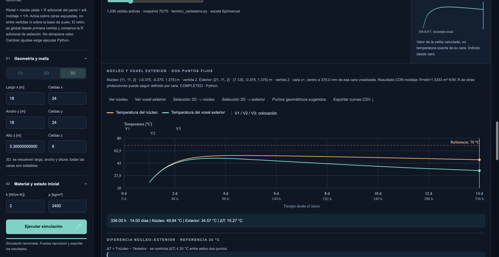
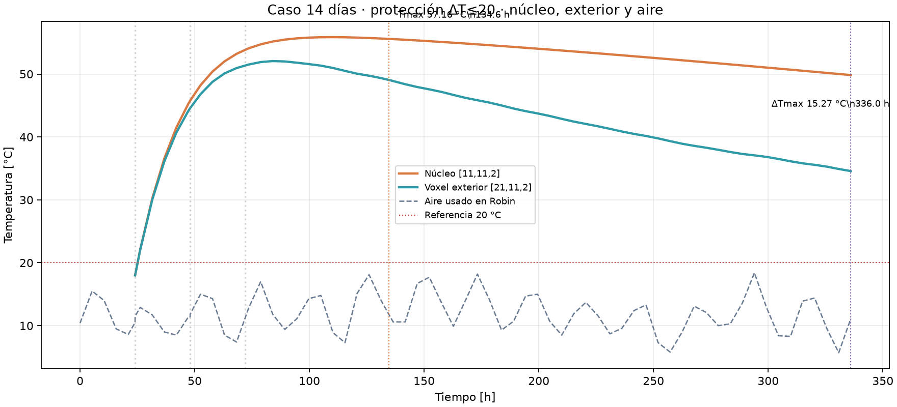
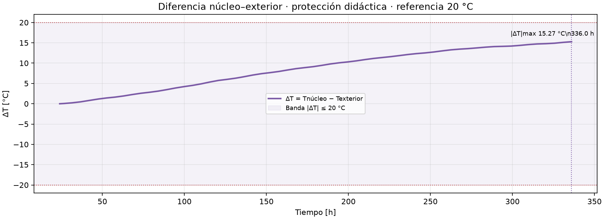
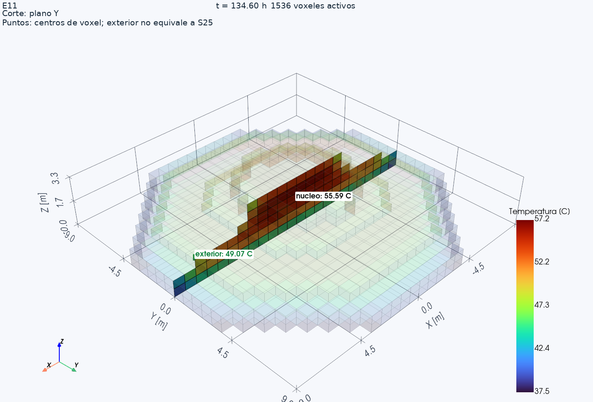
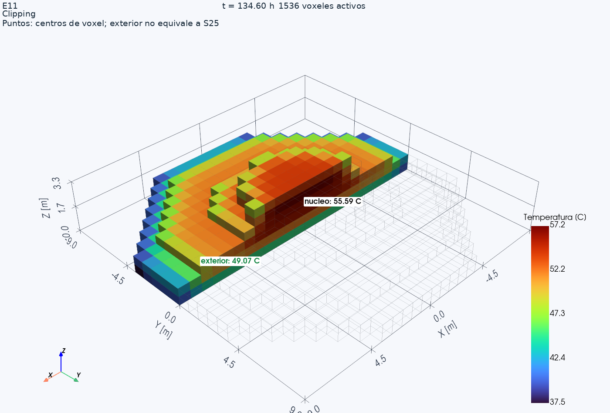

# Corrección ΔT ≤ 20 °C · caso completo de 14 días

## 1. Repositorio y commit

- Repositorio: `https://github.com/Santiago411323/Proyecto_2_MCOC`
- Commit de referencia: `b0e72c1d9adef5e14177d9cbe95bb5fec4449071` (`E11: conectar clima real y exportar simulacion 3D a VTK`).
- La corrida se ejecutó con `working_tree_dirty=true`; la corrección de panel/CLI/informes aún no tiene commit de cierre. El hash identifica el motor base.
- Corrida: `resultados/e11_14d_delta20/20261112T211806752222Z/`, `created_utc=2026-11-12T21:18:07Z`, `simulation_id=e11_forecast_3d`.
- Evidencia: `docs/e11/entrega_14d_corregida/`. El caso base queda en `docs/e11/entrega_14d/ENTREGA_14D.md`.

## 2. Forecast, dataset y timestamp

Se usó el snapshot archivado de Open-Meteo, no una observación de estación:

- Producto `forecast`; descarga `2026-11-12T12:43:25.279292Z`.
- Archivo crudo `forecast.json`, SHA-256 `3a6a828efa343ee586a3a8e211475decb13678c6a8227d700316f2875d1c5dab`.
- Cobertura: 384 h, de `2026-11-12T00:00:00Z` a `2026-11-27T23:00:00Z`.
- Física: solo `temperature_2m` (°C). `wind_speed_10m` se archiva, pero no se convierte en `h`; no se usa radiación.
- Inicio: `2026-11-12T10:00:00-03:00` = `2026-11-12T13:00:00Z`. Fin: `2026-11-26T13:00:00Z` (336 h).

## 3. Tratamiento del horizonte no cubierto

No hubo extrapolación: la simulación pidió **336 h** y el forecast dispone de **384 h**. El solver exige cobertura completa y rechaza si falta (`missing_policy=reject`); no se rellenan huecos. La temperatura se mantiene constante por intervalo horario. La ventana usada va de `2026-11-12T13:00Z` a `2026-11-26T13:00Z`; el aire varía entre **5.6 °C y 19.3 °C** (serie completa: 4.5–19.3 °C).

## 4. Condiciones de borde

Geometría: fundación IFC voxelizada, malla `24×24×6`, paso `0.75×0.75×0.55 m`, **1.536 celdas activas**, volumen **475.2 m³**. Material: `k=2 W/(m·K)`, `ρ=2400 kg/m³`, `cp=900 J/(kg·K)`, `α=9.259×10⁻⁷ m²/s`. Estado inicial: **20 °C uniforme**.

| Cara | Tipo | Temperatura | h [W/(m²·K)] | R efectiva [m²·K/W] | Comentario |
|---|---|---|---:|---:|---|
| x−, x+, y−, y+ | Robin aire | `T_aire(t)` del forecast | 10 | **1.3333** | Moldaje `e=0.20 m`, `k=0.15`; `R=e/k` |
| z+ | Robin aire | `T_aire(t)` del forecast | 10 | **1.3333** | Moldaje `e=0.20 m`, `k=0.15` |
| z− | Robin suelo | 8 °C | 1.5 | 0.05 | Reservorio basal; no usa forecast ni moldaje |

La `R` efectiva incluye el moldaje; las caras base tienen `R=0`. El exterior es un **centro de voxel** a unos **0.375 m** de la cara `x+`, no una temperatura a 25 mm. El suelo es un reservorio efectivo a 8 °C, con `L=1 m`, `k_s=1.5 W/(m·K)` y `R_contacto=0.05 m²·K/W`; no tiene capacidad térmica ni voxeles de suelo. El moldaje no se retira.

## 5. Plan de vertidas

| Vertida | ID | Inicio | Colocación | θ∞ | τ |
|---|---:|---:|---:|---:|---:|
| Vertida_01 | 1 | 0 h | 18 °C | 40 °C | 24 h |
| Vertida_02 | 2 | 24 h | 18 °C | 40 °C | 24 h |
| Vertida_03 | 3 | 48 h | 18 °C | 40 °C | 24 h |

La activación es instantánea; no se modela hormigonado continuo. Cada vertida tiene su propio reloj. La hidratación es exponencial adiabática, didáctica y **no calibrada experimentalmente**. `source=none`, `qmax=0`.

## 6. Cómo aplicarlo en el panel

1. Carga el forecast en **05B Forecast trazable · Python** y deja la secuencia constructiva en **03A**.
2. En **03B Moldaje físico · Python**, pulsa **“Aplicar protección ΔT ≤ 20 °C”**.
3. El botón fija `e=0.20 m`, `k=0.15 W/(m·K)`, activa x±/y±/z+ y deja z− al suelo.
4. Verifica motor **Python**, duración **14 días** y ejecuta.
5. En **NÚCLEO Y VOXEL EXTERIOR**, la curva debe quedar dentro de la banda de 20 °C. En esta corrida: **ΔTmax = 15.27 °C**.

El botón actualiza la procedencia y marca el resultado anterior como **STALE**; hay que volver a ejecutar. CLI equivalente:

```bash
python3 demo_e11.py data/weather/20261112T124325279292Z_a139765f \
  --inicio 2026-11-12T10:00:00-03:00 --dias 14 \
  --salida resultados/e11_14d_delta20 --proteccion-delta20
```

## 7. Verificación en el panel

Verificado el **2026-11-12** en Chrome, en `http://127.0.0.1:8767/panel_termico.html`. El botón dejó `e=0.20 m`, `k=0.15 W/(m·K)`, caras **x−, x+, y−, y+, z+** activas y **z−** sin moldaje. La corrida terminó **COMPLETED · Python**, con **1.536 celdas activas** y **70/70 snapshots**.

El panel mostró:

> ΔT = 49.84 − 34.57 = 15.27 °C. |ΔT| ≤ 20 °C entre estos dos puntos. Mayor |ΔT| registrado: 15.27 °C a 336.00 h. Oficial S25: NOT EVALUATED.

Las vertidas se activaron en **0/24/48 h**; al final, V1/V2/V3 tenían edades **336/312/288 h** y las tres seguían activas. El gráfico rotula V1/V2/V3 con colocación **18.0 °C**, escala 20–80 °C y referencia docente de 70 °C. El “peak” de la tarjeta es el máximo del **punto central** (**56.36 °C**); el `T_max` global (**57.16 °C**) está en `[11,11,4]`. **S25 / 25 mm: NOT EVALUATED**.



## 8. Resultados y criterio de 20 °C

| Métrica | Valor | Tiempo | Ubicación |
|---|---:|---:|---|
| `T_max` global | **57.16 °C** | **134.6 h** (5.61 d) | celda `[11,11,4]`, `(-0.375, -0.375, 2.475) m`, V3 |
| Máximo del punto central | 56.36 °C | 154.6 h | celda `[11,11,2]` |
| `ΔT_max` núcleo–exterior | **15.27 °C** | **336.0 h** (14.00 d) | núcleo `[11,11,2]`, `(-0.375, -0.375, 1.375) m`, V2; exterior `[21,11,2]`, `(7.125, -0.375, 1.375) m`, V2 |
| ΔT final | 15.27 °C | 336 h | núcleo 49.84 °C; exterior 34.57 °C |

En el instante de `ΔT_max`: núcleo **49.84 °C**, exterior **34.57 °C**. `first_over_20_h=null` y `last_over_20_h=null`: **no hay ningún paso con |ΔT| > 20 °C** en los 706 pasos / 336 h. El ΔT corregido **todavía aumenta lentamente al final**; no se extrapola a un horizonte mayor sin volver a simular con un forecast que lo cubra.

`T_max = 57.16 °C < 70 °C`, pero **70 °C no es un criterio validado de seguridad** y no compensa el criterio de ΔT. Residual energético relativo: **6.64×10⁻¹⁶**; 1.536 celdas activas; 475.2 m³.

## 9. Curvas núcleo/superficie





Datos: [`curvas_nucleo_superficie.csv`](curvas_nucleo_superficie.csv). Naranja: núcleo `[11,11,2]`; cyan: exterior `[21,11,2]`; punteada: aire Robin. En los 70 snapshots, el exterior alcanza **52.07 °C a 84.0 h** y luego se enfría; el núcleo alcanza **55.87 °C a 110.25 h**. Después el exterior cae más rápido y el ΔT crece hasta **15.27 °C a 336 h**. El `T_max` global **57.16 °C** es el máximo de todos los pasos, en `[11,11,4]`, no en el punto central.

## 10. Visualización 3D





Geometría y campo completo: [`vtk/`](vtk/) (70 `.vtu`, `serie.pvd` y `manifest.json`). El panel muestra **1.536 celdas activas** y **snapshot 70/70**; el corte y el clipping se generaron desde los VTK. El visor permite repetir el corte en `THERMAL X-RAY` con los controles X/Y/Z.

## 11. Conclusión

**¿El plan cumple determinísticamente?** **Sí para el criterio de 20 °C núcleo–exterior y dentro de las 336 h simuladas**: `ΔT_max = 15.27 °C < 20 °C` y no hay pasos con |ΔT| > 20 °C. **No** se declara cumplimiento más allá de los 14 días: el ΔT sigue aumentando lentamente al final. `T_max = 57.16 °C` queda bajo 70 °C, pero 70 °C no es un criterio validado.

**Mecanismo.** El calor de hidratación y la secuencia de vertidas acumulan calor en el núcleo. La superficie pierde calor por Robin al aire (`h=10`) y por el reservorio basal a 8 °C. La protección `e=0.20 m`, `k=0.15 W/(m·K)` reduce la pérdida en x±, y± y z+; el exterior se mantiene más cerca del núcleo, especialmente porque z+ deja de enfriarse. El suelo z− sigue frío y no se toca. El máximo de temperatura aparece a 134.6 h, asociado a la hidratación; el máximo ΔT aparece al final, cuando el exterior ya se ha enfriado más que el núcleo.

**Distinción.** El criterio controlado es el **par fijo núcleo–voxel exterior**. El máximo global `Tmax−Tmin` es **31.23 °C a 48.0 h** (al final, 28.48 °C), porque en la activación de V3 conviven hormigón caliente y hormigón fresco a 18 °C. Ese no es el indicador de 20 °C; si el requisito fuera el máximo global, esta protección no bastaría. **S25 / ΔT a 25 mm: NOT EVALUATED.**

**Límites.** Geometría IFC provisional; hidratación no calibrada; `h` constante; viento archivado sin efecto físico; sin radiación solar/onda larga; suelo como reservorio fijo; puntos en centros de voxel. No se declara validación experimental ni S25.

## 12. Archivos y reproducibilidad

- [`metricas_14d.json`](metricas_14d.json): `T_max`, `ΔT_max`, tiempos y ubicaciones.
- [`curvas_nucleo_superficie.csv`](curvas_nucleo_superficie.csv): 70 snapshots.
- [`metadata.json`](metadata.json), [`resumen.json`](resumen.json): configuración, clima, métricas y procedencia.
- [`vtk/`](vtk/): 70 campos 3D y manifiesto.
- [`panel_delta_verificado.png`](panel_delta_verificado.png), [`panel_verificado.png`](panel_verificado.png): capturas del panel.

Reproducibilidad: mismo forecast, configuración y comando producen los mismos valores; el solver es determinista. `python3 -m pytest tests/test_panel_ifc.py -q` → **4 passed**. El commit de cierre de panel/CLI/informes queda pendiente.
