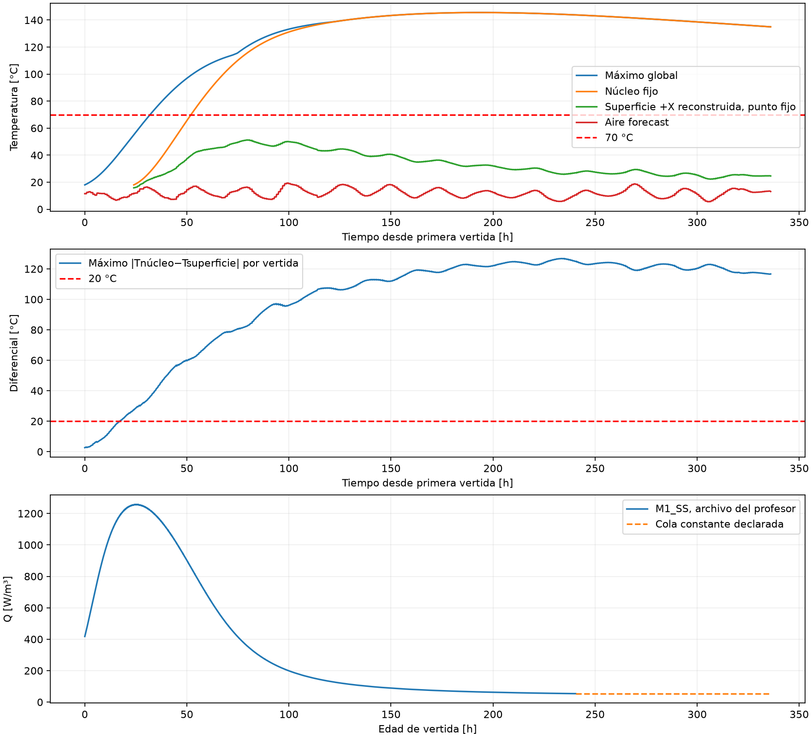
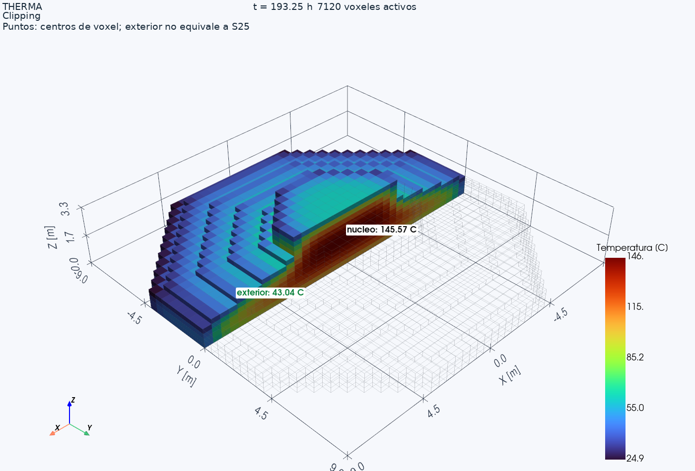
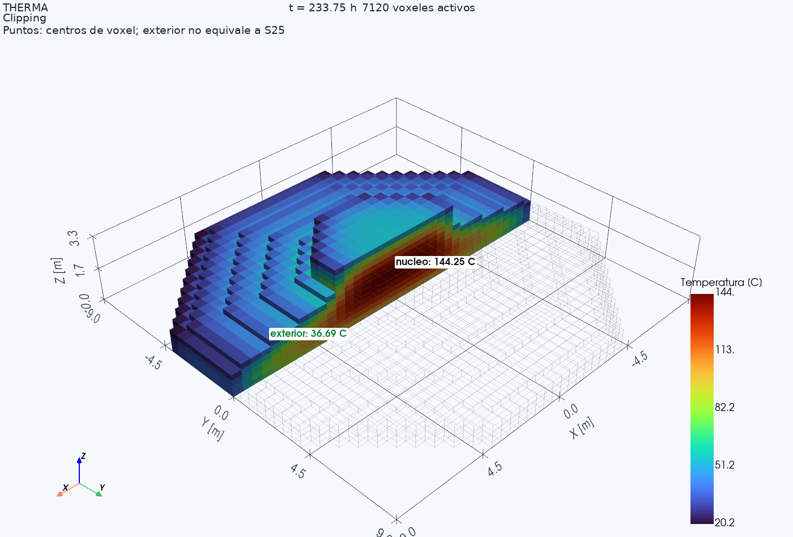

# E12 — Simulación determinista de 14 días

**Repositorio:** https://github.com/Santiago411323/Proyecto_2_MCOC

**SHA del código físico ejecutado:** `cb3511ecf86ba4bda86522bb8c63fd1acab85d33`.
El commit de entrega contiene además este informe, datos y figuras; identificarlo
con `git log -1 --format=%H -- docs/e12/ENTREGA.md`. No confundir el SHA E11 con
el código que incorpora la fuente entregada. La metadata registra el SHA de corrida.

## Caso e integración

Inicio: **13-11-2026 10:00 UTC−3**. Fin: **27-11-2026 10:00 UTC−3**: 336 horas.
La geometría viene de `modelo_e02.ifc`, interpretación provisional de tres
volúmenes contiguos; no se declara validada por el docente. Caja 18×18×3.3 m;
volumen IFC 487.07 m³. La malla 36×36×12, de 0.50×0.50×0.275 m, contiene 7120
voxeles de hormigón y 489.50 m³: error de volumen aproximado +0.50 %.

Propiedades constantes: k=2 W/(m K), ρ=2400 kg/m³ y cₚ=900 J/(kg K), de ensayo.
Balance explícito conservativo con contacto interno perfecto; cada celda genera
calor sólo después de colocarse. No se identifica una resistencia mecánica del hormigón.

| Vertida | Inicio global | Fecha local | Colocación |
|---|---:|---|---:|
| V1 | 0 h | 13-11 10:00 | 18 °C |
| V2 | 24 h | 14-11 10:00 | 18 °C |
| V3 | 48 h | 15-11 10:00 | 18 °C |

## Una sola curva de hidratación

Se seleccionó **M1_SS**, segunda columna del `source_terms.txt` entregado, campaña
13–20 abril 2025. Se usa la misma curva en las tres vertidas, con relojes de edad
independientes. El encabezado declara una fuente recuperada mediante PINN.
El archivo está conservado byte a byte en `data/hydration/source_terms.txt`;
SHA-256 `27196495c1da43f54e941d81fee22932b7a0e31911b32680d123715eeb3b7815`.

Q ya está en **W/m³**: entra como generación volumétrica y **no se multiplica por
ρcₚ**. Se interpola linealmente y se integra exactamente cada tramo para obtener
la fuente media del paso. El β del ensayo no se transfiere a la BC de la fundación.
Q alcanza 1256.849 W/m³; su integral hasta 240.46667 h equivale a una elevación
adiabática de 147.07 °C con las propiedades adoptadas. No se reescala a 70 °C.

El cero del archivo es el inicio de una ventana retenida, registro +2 h. Se alinea
ese cero con la colocación: es una hipótesis temporal declarada, no una reconstrucción
de las dos horas ausentes. Después de 240.46667 h se mantiene Q=53.751 W/m³ como
cola determinista explícita. No son datos medidos adicionales ni una garantía de
conservadurismo. Ambos máximos reportados ocurren antes de que cualquier vertida
alcance esa cola; por causalidad, dicha extensión no causa esos máximos.

## Meteorología y horizonte

Snapshot Open-Meteo `data/weather/20261112T124325279292Z_a139765f`, descargado
**12-11-2026 12:43:25.279292 UTC**. Producto forecast `best_match`, no observación;
emisión única no disponible. Coordenadas solicitadas −52.821770, −70.896850;
devueltas −52.829525, −70.91934. Contiene 384 registros horarios de aire en °C.
SHA-256 original:
`3a6a828efa343ee586a3a8e211475decb13678c6a8227d700316f2875d1c5dab`.

Cobertura: 12-11 00:00 a 27-11 23:00 UTC. La corrida termina 27-11 13:00 UTC:
**cubre todo el horizonte; no se requiere cola meteorológica**. Se usa aire
constante por intervalo horario, sin extrapolar; cada cambio horario es un evento.
El viento se archiva, pero h permanece fijo. No se modelan radiación solar u onda larga.

## Condiciones de borde

| Región expuesta | Tratamiento |
|---|---|
| Laterales x±, y± | Robin con Taire(t), h=10 W/(m² K), R adicional=0 y tablero e=0.02 m, kₘ=0.15 W/(m K): Rₘ=0.13333 m²K/W. |
| Caras z+ y escalones superiores | Robin con el mismo aire y h; sin tablero ni aislación adicional. |
| Base z− | Suelo efectivo a 8 °C, contacto 0.05 m²K/W más capa 1 m, kₛ=1.5 W/(m K). Sin convección de aire adicional. |
| Interfaces entre vertidas activas | Conducción interna; dejan de ser frontera expuesta. |

El tablero se mantiene los 14 días, sin desmolde. Suelo y tablero no tienen
almacenamiento térmico. La resistencia de media celda se incluye en serie.

## Diagnóstico 70 °C / 20 °C

Se evalúa cada paso, no sólo las imágenes. Hay 1442 pasos, Δt≤900 s y límite
local mínimo 25443.93 s. Residual energético relativo máximo: 3.87×10⁻¹⁵.
Conservación numérica no equivale a validación experimental.

**Temperatura máxima: 145.57 °C**, a **193.25 h**, 21-11-2026 11:15 UTC−3,
en V2, centro XYZ **(−0.25,−0.25,1.5125) m**. **No cumple 70 °C**.

Para el diferencial se toma, en cada instante y vertida activa, su celda más
caliente y todas sus caras aéreas expuestas. Se maximiza |Tnúcleo−Tsuperficie|
entre esos pares simultáneos. No se restan máximos de horas diferentes.

La superficie se estima con el flujo Robin y un perfil lineal de media celda:
Tsup=Ti−qsaliente Δn/(2k). **No es el centro del voxel exterior**; tampoco es
una solución independiente refinada a 25 mm. Las caras son las de la geometría voxelizada.

**ΔT máximo reconstruido: 126.81 °C**, a **233.75 h**, 23-11-2026 03:45 UTC−3,
en V2: núcleo **(−0.25,−0.25,1.5125) m**, 144.25 °C; superficie escalonada z+
**(−8.25,−3.25,1.375) m**, 17.44 °C. **No cumple 20 °C bajo esta definición**.
En ese mismo par/instante, la estimación lineal a 25 mm da un diferencial de
125.35 °C; no se presenta como máximo S25 resuelto ni como certificación normativa.

Las curvas de núcleo y superficie +X siguen puntos fijos de V2, definidos en
resumen.json; comienzan a las 24 h. El diferencial envolvente busca todas las
caras y puede corresponder a otros puntos. Las oscilaciones del aire afectan
más a la superficie; el núcleo presenta mayor inercia térmica.

Los marcadores 3D muestran el par fijo; las coordenadas del par crítico del
diferencial son las indicadas arriba y en resumen.json.

## Conclusión y reproducción

**El plan no cumple determinísticamente en el modelo adoptado.** Controla la
elevada generación volumétrica frente a una evacuación lenta desde el interior;
las superficies superiores sin protección favorecen el gran gradiente. El
moldaje lateral no basta para cumplir. No se optimizó el plan para forzar aprobación.

Las temperaturas muy elevadas señalan además límites del modelo sensible:
propiedades constantes, sin evaporación/calor latente ni cinética dependiente de
temperatura. Se requiere revisar la transferencia de la fuente de probeta al caso
y la geometría antes de usar los valores como predicción física de obra. No se
certifica seguridad ni se afirma resuelto S25; la falla del umbral de temperatura
ya descarta aprobar este escenario numérico.

Repetir: `python ejecutar_e12.py --salida resultados/e12_nueva` con el entorno
`requirements-viz.txt`. Abrir `python ver_resultados_3d.py docs/e12/evidencia/vtk`;
para el campo del máximo diferencial usar `docs/e12/evidencia/critico_delta`.
En THERMA Lab, reiniciar `servidor_therma.py` y recargar la página. **Cargar ajustes** → `docs/e12/evidencia/config.json` conserva
M1_SS; el diagnóstico superficial del informe se calcula con el script E12.
Pruebas: `python -m pytest -q`: **255 aprobadas**.
