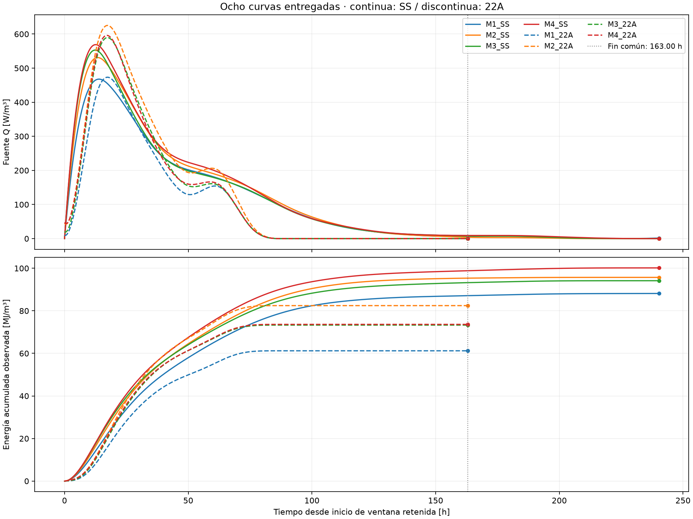

# E13 — Paso 1: entender los datos de hidratación

Se inspeccionaron las ocho columnas de `data/hydration/source_terms.txt`.
Se usa la fuente FV/Tikhonov confirmada por el usuario el 16-11-2026.
El archivo PINN previo fue retirado por datos incorrectos. No se asignaron probabilidades.

El archivo declara Q en W/m³, recuperada mediante FV/Tikhonov para probetas cilíndricas
de radio 0.0375 m y altura 0.15 m. No son temperaturas medidas ni curvas de
incremento adiabático. No multiplicar Q por densidad y calor específico.
El tiempo está en horas y comienza en una ventana retenida, registro +2 h.
El beta declarado corresponde al ensayo; no es automáticamente el h de la fundación.

Cada color identifica M1-M4. Línea continua: campaña SS (13–20 abril 2025);
discontinua: campaña 22A (22 abril 2025). Los puntos marcan el último dato:
las líneas terminan allí porque no conocemos su continuación.

Arriba se muestra potencia por volumen: una curva más alta libera energía más
rápido en ese instante. Abajo se muestra su integral: energía acumulada por
volumen. El pico más alto no identifica necesariamente la mayor energía total.
Para integrar se convierten horas a segundos; W·s/m³ = J/m³.

SS cubre hasta 240.333 h; 22A tiene datos finitos hasta 163.0 h.
Para comparar integral en igualdad de condiciones se usa el final común, 163.0 h: columna energy_common_MJ_m3
del CSV. No comparar integral total SS y 22A como si cubrieran igual duración.
Los NaN al final de 22A son ausencia de información, no Q=0.

Ninguna curva cubre edad 336 h. Antes de simular hay que declarar y estudiar
el efecto de una política de cola. Este paso no extiende las curvas.
La cola constante empleada en E12 fue una hipótesis; no se convierte aquí
en evidencia experimental ni se copia automáticamente a ocho escenarios.

El CSV incluye la elevación adiabática equivalente de la energía observada
usando rho=2476 kg/m³ y cp=1023 J/(kg K), declarados en el encabezado vigente. Es sólo una conversión con esas propiedades, no una temperatura observada ni una predicción térmica de la fundación.

## Lo que falta saber antes de asignar pesos

¿M1-M4 tienen la misma receta o son mezclas distintas? ¿Qué temperatura inicial,
condiciones de ensayo corresponden a cada muestra? El contenido de cemento
de referencia declarado es 350.77 kg/m³.
¿Qué evidencia respalda la identificación de Q? El encabezado no resuelve todas esas preguntas. No se puede afirmar todavía que las ocho curvas sean réplicas
equiprobables. Si siguen faltando antecedentes, se pueden declarar escenarios
de incertidumbre de modelo y estudiar sensibilidad de los pesos, explicando el supuesto.

Este paso no selecciona una mezcla ni calcula probabilidad de falla. El siguiente
paso es fijar la interpretación material, el origen temporal y la cola para
utilizar cada historia completa sin mezclar sus puntos.

Repetir desde la raíz: `.\.venv\Scripts\python.exe analizar_curvas_e13.py`.
Fuente y SHA-256 están en `auditoria.json`; estadísticas en `resumen.csv`.
