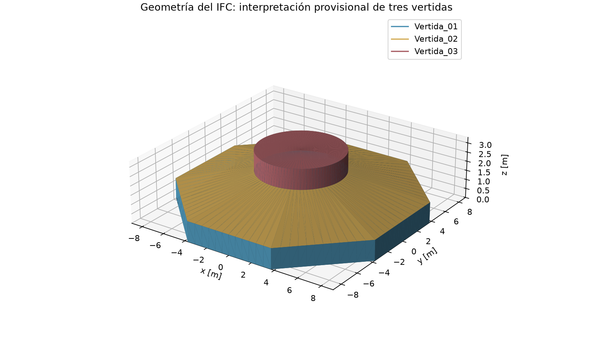
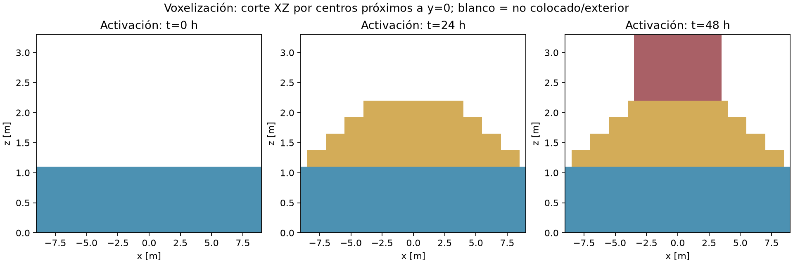
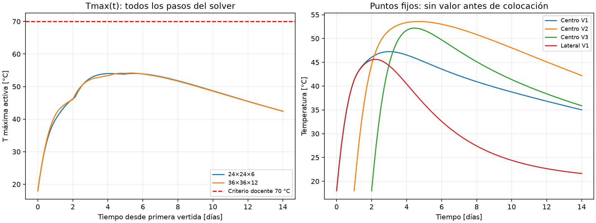
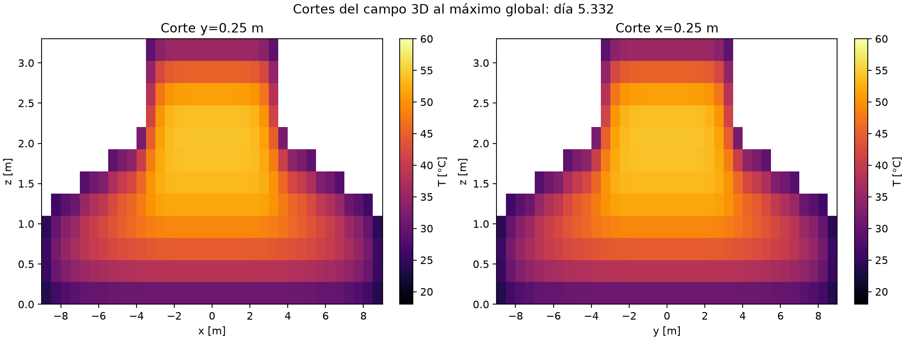

# E09 — Primera simulación 3D de la fundación

## Procedencia y reproducción

Repositorio: [Proyecto_2_MCOC](https://github.com/Santiago411323/Proyecto_2_MCOC).
Commit base de la corrida: `0f0aae1c8b7fd886a0342af9f3f4fcf1a80bef82`. Corrida del 6 de noviembre de 2026 con la corrección de exportación sin Git y el script de evidencia incluidos en esta entrega. Se adjuntan el parche respecto de la base, configuración, CSV, resumen y hashes en `manifiesto.json`. Para identificar el commit que contiene esta entrega, ejecutar `git log -1 --format=%H -- docs/entrega_e09/ENTREGA.md`. Los resultados originales se generaron sobre árbol con cambios; el SHA base por sí solo no contiene esos cambios.

Reproducción desde la raíz, con dependencias de `requirements-lock.txt`:

```powershell
./.venv/Scripts/python.exe generar_entrega_e09.py
```

Los campos completos y metadatos se regeneran en `resultados/entrega_e09/malla_0` y `malla_1`. Las figuras y series quedan junto a este documento.

## Geometría, BIM y voxelización

Se usa `modelo_e02.ifc`, IFC4 con tres `IfcFooting` identificables por nombre y GUID. La envolvente mide 18×18×3,30 m, con base octagonal, transición inclinada y cilindro superior de diámetro 7 m. Es una **interpretación provisional del equipo**, no geometría oficial validada. Difiere de la simplificación de cinco vertidas y 4,30 m de altura de `GUIA_BONSAI_FUNDACION.md`; se requiere confirmar cuál acepta el profesor.



Se triangula el IFC y se clasifica el centro de cada celda dentro/fuera del sólido, conservando su vertida. Volumen geométrico: **487.070 m³**, calculado desde las mallas cerradas; no se usa el volumen de la caja envolvente. Se evalúa el volumen ocupado total, independientemente del horario de activación:

| Celdas de la caja | Volumen ocupado [m³] | Error absoluto relativo |
|---|---:|---:|
| 24×24×6 | 475.200 | 2.437 % |
| 36×36×12 | 489.500 | 0.499 % |
| 48×48×18 | 483.863 | 0.658 % |

Las dos primeras mallas también se simulan térmicamente; la tercera sólo verifica volumen. El error de volumen no disminuye monótonamente: depende de la alineación con las superficies. El refinamiento geométrico no constituye por sí solo convergencia térmica.



## Vertidas y material

| Vertida | Intervalo z [m] | Inicio [h] | Colocación [°C] |
|---|---|---:|---:|
| 01 | 0–1,10 | 0 | 18 |
| 02 | 1,10–2,20 | 24 | 18 |
| 03 | 2,20–3,30 | 48 | 18 |

Cada pieza se activa instantáneamente. Antes de su colocación no conduce, genera ni almacena calor. Al activarse se inicializa a 18 °C y se reconstruyen interfaces y caras expuestas; el contacto entre vertidas es perfecto. M1 es una etiqueta didáctica: k=2 W/(m·K), ρ=2400 kg/m³ y cp=900 J/(kg·K), constantes. No hay dosificación ni grado resistente calibrado.

## Hidratación, ambiente y método

Para edad cronológica a desde la colocación de cada vertida:

$$\theta_{ad}(a)=40[1-\exp(-a/\tau)],\qquad \tau=24\ \mathrm{h}.$$

$$\dot q(a)=\rho c_p\frac{40}{\tau}\exp(-a/\tau).$$

En la fuente τ se convierte a segundos; q está en W/m³. La elevación final de 40 °C y τ son **hipótesis de ensayo**, no ajustes a 73 °C ni resultados calorimétricos. Cada vertida tiene su reloj y se integra exactamente el aporte de fuente por intervalo. No se representa la dependencia cinética con temperatura ni una fase de inducción.

Se simulan 14 días con balance explícito por celdas. En **todas** las caras exteriores, incluida la base, se usa Robin con ambiente constante de 20 °C, h=10 W/(m²·K) y resistencia adicional cero. La base recibe este intercambio efectivo simplificado: no se modela físicamente suelo. No hay clima real de Punta Arenas, radiación, moldaje ni retiro de protecciones. El paso automático respeta conductancias locales, eventos y resolución de hidratación. En la malla principal hay 7120 celdas ocupadas, de 0,50×0,50×0,275 m; el paso máximo usado es 2160 s frente al límite local mínimo de 24922 s.

## Resultados e interpretación

En la malla principal 36×36×12, Tmax global es **54.16 °C** a las **127.98 h** (5.33 días). El máximo se busca en todo el hormigón activo en cada paso, no sólo en un sensor. Con 24×24×6 se obtienen 54.03 °C: diferencia de 0.13 °C; hacen falta más refinamientos y estudio temporal para afirmar independencia de malla.



Los sensores corresponden a centros ocupados más próximos a posiciones solicitadas; las coordenadas efectivas son:

| Punto | x,y,z [m] | Máximo muestreado [°C] | T a 14 días [°C] |
|---|---|---:|---:|
| Centro V1 | -0.250, -0.250, 0.688 | 47.24 | 35.02 |
| Centro V2 | -0.250, -0.250, 1.513 | 53.58 | 42.23 |
| Centro V3 | -0.250, -0.250, 2.613 | 52.18 | 35.88 |
| Lateral V1 | 7.750, -0.250, 0.688 | 45.62 | 21.64 |

Los máximos de sensores usan los snapshots guardados, no todos los pasos. No se asigna temperatura física antes de activar la vertida. Los cortes muestran acumulación interior y disipación periférica:



El residual energético relativo máximo es 2.15e-15, incluyendo energía de colocación, hidratación e intercambio. Pasaron 40 pruebas de hidratación, activación, construcción y exportación; conservación no equivale a validación experimental. Tmax queda bajo 70 °C en este escenario, pero no demuestra seguridad del plan. **No se evalúa ΔT a 25 mm**: los centros de esta grilla no representan esa profundidad.

## Comparación cualitativa con Ju y Lei

[Ju y Lei (2019)](https://doi.org/10.1155/2019/7029671) es la referencia física. La comparación se apoya en sus figuras descritas en la presentación del curso (diapositivas 3–5 y 13), sin digitalizar series del artículo. Se reproduce cualitativamente el calentamiento por hidratación, un máximo diferido durante los primeros días, posterior enfriamiento y un interior más caliente que las zonas expuestas. La activación incorpora además diferentes edades térmicas por vertida.

No se reproducen cuantitativamente los aproximadamente 73 °C alrededor del día 4 ni el diferencial vertical próximo a 35 °C del día 9 descritos en ese material. Tampoco se reproducen mezcla, cronograma, sensores, clima ni restricciones mecánicas experimentales. La ley exponencial, geometría provisional y bordes simplificados explican diferencias posibles, pero no identifican su contribución individual. Faltan calibración y validación para estimar fisuración o recomendar una construcción real.
