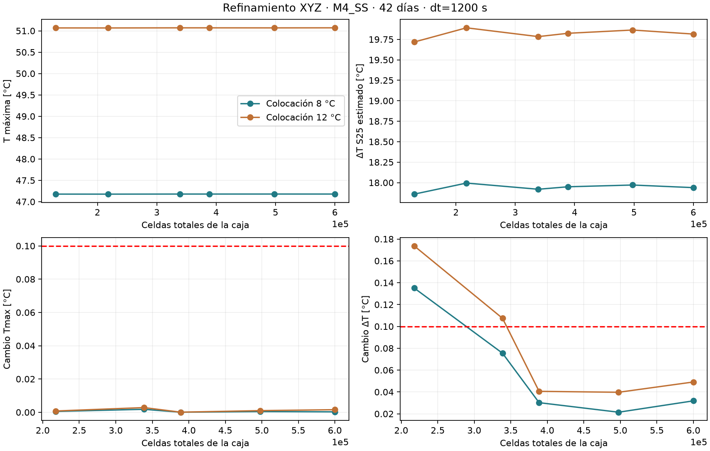

# Continuación del estudio de mallas

Se conserva geometría IFC, fuente M4_SS, clima congelado y su cola hipotética, propiedades, aislación y cronograma. Se estudian colocaciones a 8 y 12 °C. Horizonte 42 días, dt solicitado 1200 s y 40 snapshots.

Los resultados previos refinaban de 84×84×48 a 90×90×48 sin cambiar altura. Se añaden 96×96×54 y 100×100×60 para refinar los tres ejes. Se reporta sensibilidad; no se ajusta la malla para obtener cumplimiento.

|T colocación|Malla|Voxeles activos|Tmax °C|ΔT estimado °C|Cambio Tmax °C|Cambio ΔT °C|Puntos sin soporte|Error volumen %|

|---|---|---|---|---|---|---|---|---|

|8|60×60×36|59164|47.17813|17.85934|—|—|0|0.21218|

|8|72×72×42|98680|47.17763|17.99446|0.00050|0.13512|0|-0.50922|

|8|84×84×48|154528|47.17940|17.91900|0.00178|0.07546|0|0.15563|

|8|90×90×48|176628|47.17938|17.94920|0.00002|0.03020|0|-0.27563|

|8|96×96×54|225936|47.17979|17.97066|0.00041|0.02146|0|-0.34084|

|8|100×100×60|272596|47.17955|17.93881|0.00024|0.03186|0|-0.26761|

|12|60×60×36|59164|51.06758|19.71724|—|—|0|0.21218|

|12|72×72×42|98680|51.06682|19.89093|0.00075|0.17370|0|-0.50922|

|12|84×84×48|154528|51.06963|19.78351|0.00281|0.10742|0|0.15563|

|12|90×90×48|176628|51.06958|19.82407|0.00005|0.04056|0|-0.27563|

|12|96×96×54|225936|51.06861|19.86379|0.00098|0.03972|0|-0.34084|

|12|100×100×60|272596|51.07014|19.81466|0.00154|0.04912|0|-0.26761|

- Colocación 8 °C: **SENSIBILIDAD_ESPACIAL_MENOR_0_10_C**.

- Colocación 12 °C: **SENSIBILIDAD_ESPACIAL_MENOR_0_10_C**.

Criterio declarado: ambos cambios <0,10 °C en los últimos dos refinamientos, estabilidad, conservación energética, horizonte capturado y muestreo S25 completo. Una diferencia pequeña entre dos mallas no es una cota de error; el escalonamiento de frontera puede producir oscilaciones. No se aplica Richardson sin evidenciar régimen asintótico.

El control temporal anterior (1200/1800 s) corresponde a 90×90×48. Se añade control 1200/900 s en 100×100×60 para el plan de 8 °C; ver control_temporal.json. La cobertura es la de los puntos muestreados, no garantía de todos los puntos de la superficie.

La fuente no incorpora cinética dependiente de temperatura. Los resultados mantienen hipótesis constructivas y climáticas anteriores. La evaluación oficial de S25 sigue no validada.

Reproducir: `.venv/Scripts/python.exe continuar_convergencia_f02.py` y `.venv/Scripts/python.exe informar_refinamiento_xyz.py`. Evidencia individual en `docs/hielo_f02/convergencia/`; campos en `resultados/hielo_f02/cache/`. Recursos: 600.000 celdas, 1,5 GiB estimado y 3.000 millones de celda-pasos; corridas secuenciales.

## Selección de malla

Para estos planes y este escenario M4_SS se recomienda **96×96×54**, con Δx=Δy=187,5 mm y Δz=61,11 mm, **225.936 voxeles activos** y 497.664 celdas totales. Se usa **100×100×60** como comprobación más fina: su diferencia satisface la tolerancia elegida. La recomendación es un compromiso de costo y sensibilidad; la familia anisótropa y el borde escalonado impiden afirmar una tasa asintótica o un error absoluto garantizado.

El estudio no prueba la misma precisión para las otras fuentes, otras protecciones o un clima distinto. Antes de publicar un nuevo plan, contrastar al menos su caso crítico en la malla de comprobación. Para el plan de 12 °C el margen térmico cercano a 20 °C exige cautela: la sensibilidad menor a 0,10 °C no convierte S25 en una evaluación formal validada.

## Paso temporal

- Colocación 8 °C, 100×100×60, 1200→900 s: cambio Tmax=0.000965 °C; cambio ΔT=0.000742 °C.

## Usar la malla en THERMA

En **02 Configurar plan → Resolución de voxeles y S25**, seleccionar **Estudio M4_SS · 96×96×54**. Esta opción sólo cambia la malla de las entradas actuales; exige ejecutar Python de nuevo. Para reproducir el caso completo, usar **Cargar ajustes** con `config_T8_96x96x54.json` o `config_T12_96x96x54.json` de esta carpeta. Las corridas publicadas de otras fuentes no se sustituyen automáticamente.