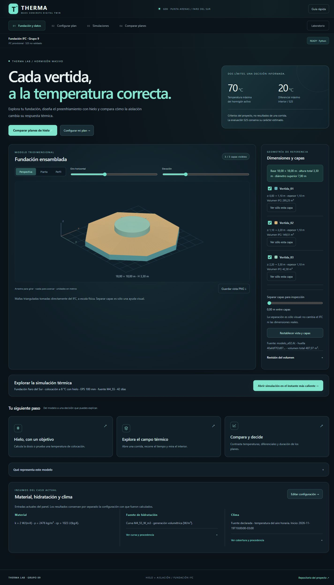

# Interfaz THERMA Lab

El panel se organiza en Fundación y datos, Configurar plan, Simulaciones,
Comparar planes y Laboratorio. La portada ofrece accesos a los planes de hielo,
al ensayo de dosis y a los resultados guardados.

En Configurar plan, elegir entre plan completo y ensayo rápido. El ensayo
rápido conserva su propio caso congelado. Para la aislación exterior, el
auxiliar convierte espesor en mm y conductividad en R [m²·K/W]; el botón
reemplaza la R adicional de las cinco orientaciones al aire. El contacto basal
y el moldaje se configuran por separado. Aplicar cambios exige recalcular.

Los límites de 70 °C y 20 °C se presentan como criterios del proyecto. Los
resultados mantienen sus datos de procedencia y la condición estimada de S25.

Fuentes del diseño: `panel/diseno.css`, `panel/diseno.js` y
`panel/fundacion.js`. Regenerar con `python construir_panel.py` y servir con
`python servidor_therma.py --port 8767`. El generador publica el ejemplo local
96×96×54 cuando sus campos están disponibles; los campos volumétricos quedan
en `resultados/`.

Revisión visual realizada en escritorio y móvil; verificados navegación,
guía rápida, formularios, conversión de aislación, comparación de hielo y
carga del campo térmico real. Pruebas del panel, hielo y comparador:
53 aprobadas y 1 omitida por campos locales de otra corrida no disponibles.

