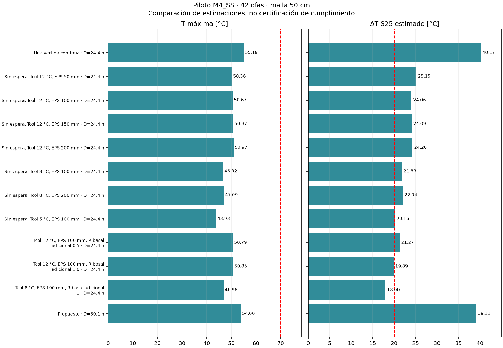
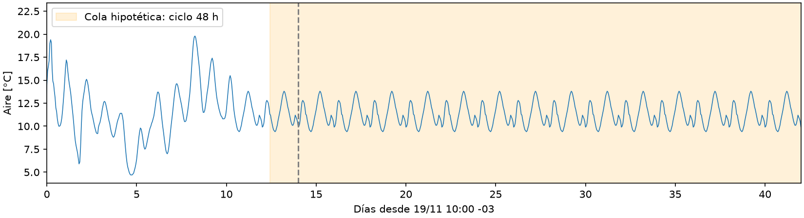
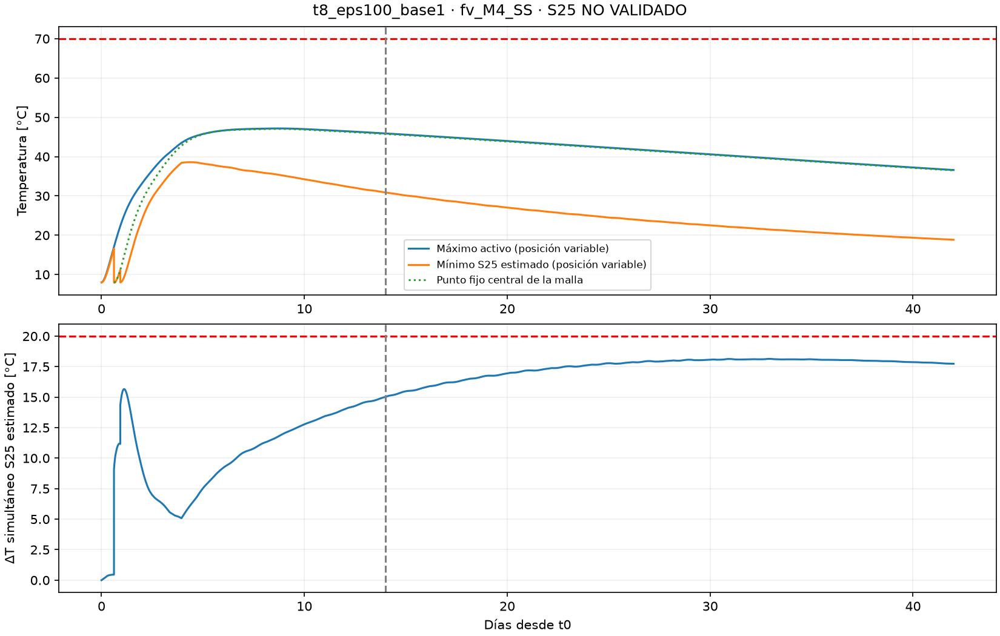
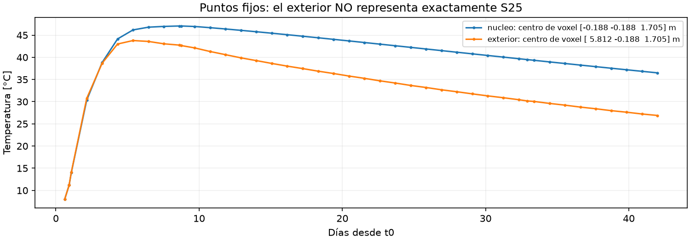
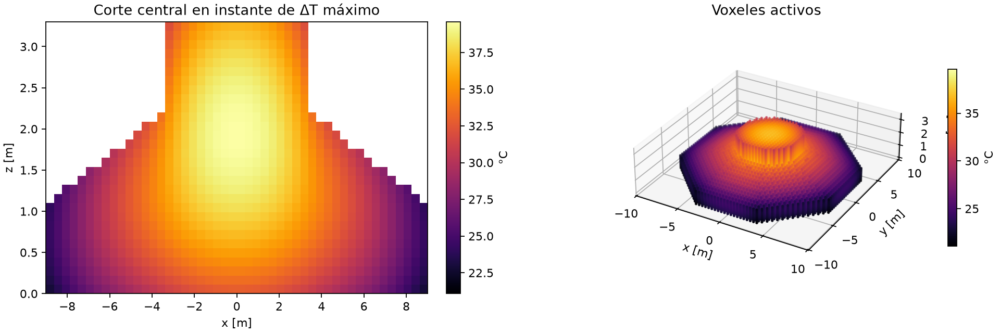
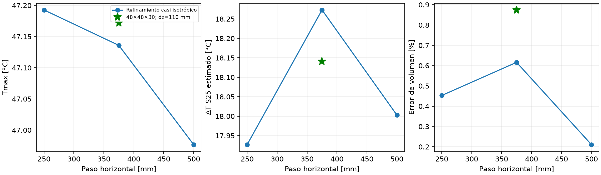

# Simulaciones de mejora y estudio de malla — F02

Resultados de experimentos numéricos; **no constituyen todavía cumplimiento certificado**. Inicio común: 19/11/2026 10:00, UTC−03. Geometría y fuentes FV originales conservadas; no se ajusta la fuente para cumplir límites.

## Diseño y trazabilidad

Snapshot Open-Meteo descargado 2026-11-16T21:46:36.704354+00:00; cobertura real hasta 2026-12-01T23:00:00+00:00. Después se repite el último ciclo completo de 48 horas, explícitamente como hipótesis. Se comparan 14 y 42 días. No es un pronóstico real de 42 días.

Fuentes: cuatro curvas SS completas, mismo material supuesto y misma curva en todas las vertidas. La identidad de mezcla no está demostrada; no se mezclan las 22A ni se seleccionan valores horarios. El piloto usa M4; la confirmación evalúa las cuatro SS. Pesos hipotéticos no equivalen a probabilidades de obra.

k=2 W/(m K), ρ=2476 kg/m³, cp=1023 J/(kg K); aire Robin h=10 W/(m² K), sin viento ni radiación. Suelo reservorio 8 °C, profundidad efectiva 1 m, k=1,5, Rcontacto=0,05. Moldaje lateral 20 mm, k=0,15. Aislación exterior k=0,038, espesor por plan; permanece todo el horizonte. Su retiro requiere otro estudio.

Tasa común 20 m³/h, un equipo, sin solapamiento. Sin esperas: D=24,3535 h. La activación térmica ocurre al inicio de cada una de las tres piezas; no reproduce llenado continuo. Los casos con resistencia basal adicional son hipótesis constructivas que requieren aprobación estructural/geotécnica; no se cambió arbitrariamente la temperatura ni conductividad del suelo.

## Resultados

| fase | plan | fuente | Tmax14_C | Delta14_estimado_C | Tmax42_C | Delta42_estimado_C | horizonte_capturado |
|---|---|---|---|---|---|---|---|
| piloto | propuesto | fv_M4_SS | 54.004 | 39.111 | 54.004 | 39.111 | True |
| piloto | continua | fv_M4_SS | 55.193 | 40.170 | 55.193 | 40.170 | True |
| piloto | t12_eps50 | fv_M4_SS | 50.356 | 24.339 | 50.356 | 25.154 | True |
| piloto | t12_eps100 | fv_M4_SS | 50.667 | 22.219 | 50.667 | 24.063 | True |
| piloto | t12_eps150 | fv_M4_SS | 50.865 | 21.334 | 50.865 | 24.095 | True |
| piloto | t12_eps200 | fv_M4_SS | 50.975 | 20.908 | 50.975 | 24.265 | True |
| piloto | t8_eps100 | fv_M4_SS | 46.818 | 20.098 | 46.818 | 21.833 | True |
| piloto | t8_eps200 | fv_M4_SS | 47.086 | 18.928 | 47.086 | 22.040 | True |
| piloto | t5_eps100 | fv_M4_SS | 43.934 | 18.507 | 43.934 | 20.162 | True |
| piloto | t12_eps100_base0.5 | fv_M4_SS | 50.785 | 18.284 | 50.785 | 21.268 | True |
| piloto | t12_eps100_base1.0 | fv_M4_SS | 50.846 | 16.521 | 50.846 | 19.894 | True |
| piloto | t8_eps100_base1 | fv_M4_SS | 46.977 | 15.674 | 46.977 | 18.003 | True |
| confirmacion | propuesto | fv_M1_SS | 49.763 | 35.358 | 49.763 | 35.358 | True |
| confirmacion | propuesto | fv_M2_SS | 52.894 | 38.143 | 52.894 | 38.143 | True |
| confirmacion | propuesto | fv_M3_SS | 51.874 | 37.267 | 51.874 | 37.267 | True |
| confirmacion | propuesto | fv_M4_SS | 54.004 | 39.111 | 54.004 | 39.111 | True |
| confirmacion | t8_eps100_base1 | fv_M1_SS | 42.338 | 13.238 | 42.338 | 16.157 | True |
| confirmacion | t8_eps100_base1 | fv_M2_SS | 45.512 | 14.877 | 45.512 | 17.167 | True |
| confirmacion | t8_eps100_base1 | fv_M3_SS | 44.701 | 15.137 | 44.701 | 16.869 | True |
| confirmacion | t8_eps100_base1 | fv_M4_SS | 46.977 | 15.674 | 46.977 | 18.003 | True |
| fuentes_finas | t8_eps100_base1 | fv_M1_SS | 42.514 | 13.182 | 42.514 | 16.290 | True |
| fuentes_finas | t8_eps100_base1 | fv_M2_SS | 45.703 | 14.840 | 45.703 | 17.294 | True |
| fuentes_finas | t8_eps100_base1 | fv_M3_SS | 44.895 | 15.124 | 44.895 | 16.993 | True |
| fuentes_finas | t8_eps100_base1 | fv_M4_SS | 47.172 | 15.661 | 47.172 | 18.141 | True |

Los CSV incluyen tiempos, coordenadas y región fría. Los máximos de Tmax y ΔT ocurren en instantes distintos; el ΔT siempre resta temperaturas simultáneas.

Archivos 3D inspeccionables: `instante_Tmax.vtu` e `instante_Delta_max.vtu`. En ParaView: Open, Apply, colorear por T_C y usar Slice o Clip. Sólo contienen hormigón activo; temperatura asociada a celdas.

## Malla y paso temporal

| caso | voxeles_activos | celdas_caja | Tmax_C | Delta_estimado_C | error_volumen_pct | S25_sin_soporte | dt_s |
|---|---|---|---|---|---|---|---|
| h500 | 4124 | 9072 | 46.977 | 18.003 | 0.211 | 0 | 900.000 |
| h375 | 9388 | 20736 | 47.136 | 18.273 | 0.616 | 24 | 900.000 |
| h250 | 32912 | 72576 | 47.193 | 17.927 | 0.453 | 88 | 900.000 |
| z110 | 31212 | 69120 | 47.172 | 18.141 | 0.874 | 0 | 900.000 |
| dt900_21d | 32912 | 72576 | 47.193 | 16.942 | 0.453 | 88 | 900.000 |
| dt450_21d | 32912 | 72576 | 47.191 | 16.941 | 0.453 | 88 | 450.000 |
| dt450_h375 | 9388 | 20736 | 47.134 | 18.272 | 0.616 | 24 | 450.000 |

Comparar h500/h375/h250 con dt=900 s y horizonte de 42 días. z110 conserva paso horizontal 375 mm y reduce el vertical a 110 mm. Comparar dt900_21d/dt450_21d con la MISMA malla y horizonte de 21 días; comparar h375/dt450_h375 para 42 días. Los máximos de 21 días no sustituyen los del horizonte extendido. Se informan cambios entre mallas, no una cota rigurosa de error ni convergencia asintótica demostrada.

La reconstrucción S25 aproxima 25 mm bajo superficies IFC. Las zonas sin soporte, el escalonamiento de la frontera y la sensibilidad espacial impiden certificar Pf≤5 %. Residuo de energía pequeño demuestra conservación discreta, no exactitud física.

## Reproducción

Desde la raíz: `.venv/Scripts/python.exe simular_mejoras_f02.py piloto`; luego `confirmar --plan ID` y `malla --plan ID`; finalmente `.venv/Scripts/python.exe exportar_mejoras_f02.py`. Catálogo congelado, escenarios, metadata y config acompañan este informe. Resultados voluminosos en `resultados/mejoras_f02/cache/`. No se ha publicado un commit nuevo.

La conclusión final debe separar candidato térmico, factibilidad constructiva y verificación numérica. Un valor estimado bajo el límite no autoriza a etiquetar el plan como CUMPLE.

## Candidato y decisión provisional

En la malla 48×48×30, entre 4 curvas SS evaluadas, Tmax máximo=47.172 °C y ΔT estimado máximo=18.141 °C. Casos que exceden los límites estimados: 0/4. Este recuento NO certifica una probabilidad de falla de obra ni reemplaza el criterio S25 validado.

Usar provisionalmente 48×48×30 (Δx=Δy=0,375 m, Δz=0,11 m) para estudiar este candidato; contrastarla con 72×72×14. 31.212 voxeles activos, 69.120 celdas de caja. Resuelve más capas verticales y todos los puntos S25 muestreados en este caso. No se demuestra convergencia universal ni basta contar voxeles: el error de volumen y de frontera también importan.

El candidato exige 8 °C de colocación, 100 mm de aislación exterior y R adicional basal=1 m²K/W; protección mantenida 42 días. No se ha demostrado factibilidad de refrigeración, capacidad portante de una capa basal, ni seguridad después del retiro. Q se conserva por edad sin corrección térmica; el cambio de cinética con la temperatura no se modela. Es una alternativa para validar, no una especificación constructiva aprobada.

## Sensibilidad meteorológica

| climate_shift_C | Tmax_C | Delta_estimate_C | horizon_captured |
|---|---|---|---|
| -3.000 | 47.116 | 19.057 | True |
| 3.000 | 47.236 | 17.462 | True |

Desplazamientos de ±3 °C de toda la historia meteorológica, manteniendo ciclo y persistencia; no son percentiles ni tienen probabilidades asignadas. El suelo conserva 8 °C. Se evalúa M4 en la malla recomendada. No se han enumerado todas las combinaciones fuente×clima.