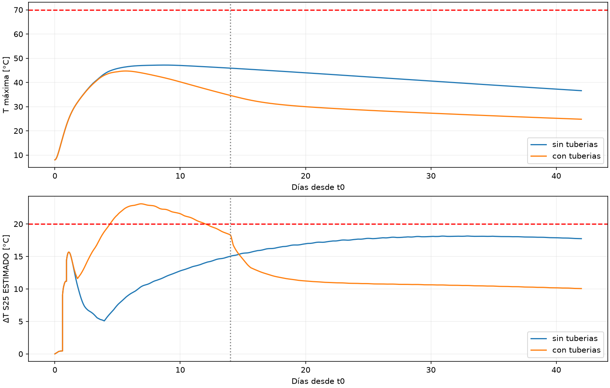

# Enfriamiento por tuberías

Comparación del mismo candidato F02 con y sin tuberías: fuentes, clima, aislación exterior y basal, vertidas y malla se conservan. Agua 10 °C, 0,1 kg/s **por circuito**, Ul=8 W/(m K), separación lateral 2 m, cotas 0,55/1,65/2,75 m. Encendido a las 24 h y apagado a las 336 h; simulación continúa hasta 42 días. Parámetros hipotéticos, no diseño hidráulico validado.

- [sin_tuberias](http://127.0.0.1:8767/?result=20153a9ec8a94c08b09538f686802468): Tmax=47.172 °C; ΔT estimado=18.141 °C; calor neto extraído=0.00 MJ.
- [con_tuberias](http://127.0.0.1:8767/?result=4a8cd148431d498db73e4c573a6d6510): Tmax=44.723 °C; ΔT estimado=23.101 °C; calor neto extraído=18281.66 MJ.

El modelo calcula la temperatura del agua a lo largo de cada circuito, supone entrada acondicionada constante y transfiere idéntica energía con signos contrarios. Conductancia efectiva desde temperatura media del voxel: no resuelve gradientes radiales junto al tubo, pared, bomba ni chiller. Las líneas cian del visor representan el trazado esquemático voxelizado, no diámetro real. El cumplimiento S25 sigue siendo estimado, no certificado.

Reproducir: `.venv/Scripts/python.exe simular_tuberias_f02.py`. Los JSON de configuración se pueden cargar en el panel.

Los enlaces a `127.0.0.1` abren las corridas guardadas en el equipo donde se ejecutó el estudio. Los campos completos de `resultados/` no se versionan; en otro equipo se deben reproducir las corridas. Las tablas, historias, configuraciones y figuras de esta carpeta sí forman parte de la entrega.
